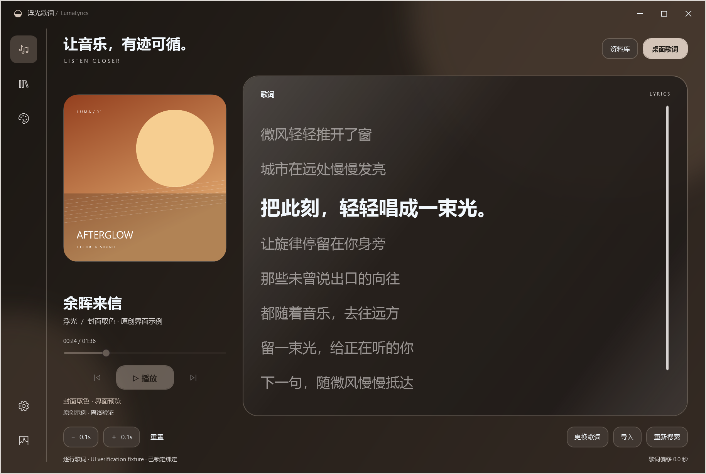
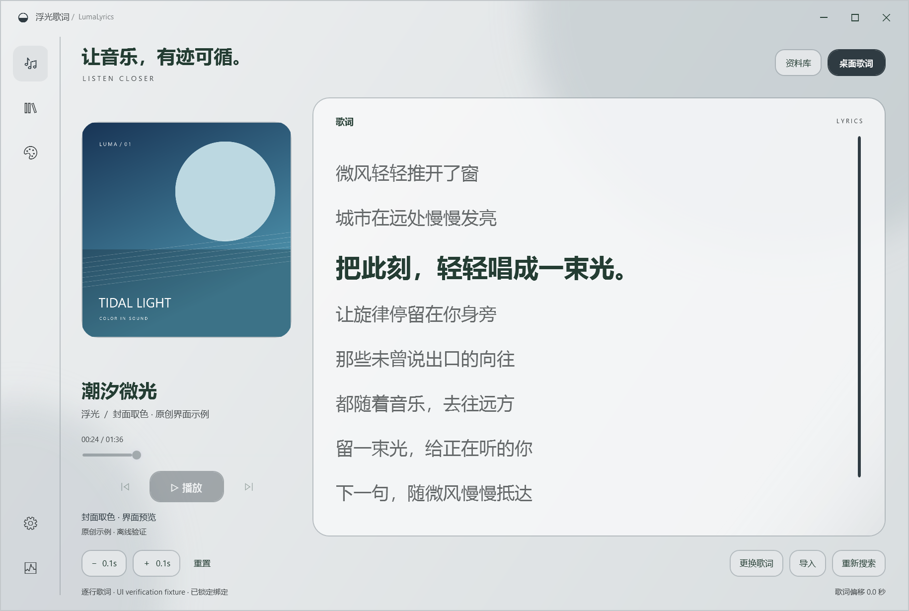

# 浮光歌词 LumaLyrics 0.9.1

Windows 桌面歌词应用。Apple Music 负责播放，浮光歌词预缓存资料库封面与动态歌词，支持独立的透明悬浮歌词窗口。

## 这次更新

- 修复专辑封面在后台导入完成后仍为空的问题。导入过程中自动分批更新封面，重新进入音乐库也会读取最新缓存，同时保留搜索、所选专辑、歌曲选择、滚动位置和播放状态。暂时读取失败时保留当前页面。[封面更新说明](docs/music-library.md)。
- 音乐库默认以专辑封面排列，点击专辑后选择其中的歌曲；返回时保留专辑搜索和滚动位置，也可切换到全部歌曲。三种主题均支持专辑网格，封面按需解码、列表按行虚拟化。[专辑浏览与播放说明](docs/music-library.md)。
- 已实测 Apple Music 完全后台点播的可行性：最小化时原生菜单没有可用的播放命令，当前可靠方案仍可能短暂恢复窗口，因此本版暂缓完全后台点播。
- 主界面左侧新增「音乐库」，可浏览本机完整 Apple Music 资料库，按歌曲、艺人、专辑搜索和排序，双击、Enter 或点击播放。保留独立缓存管理入口与底部播放控制。[音乐库使用说明](docs/music-library.md)。
- 优化液态玻璃悬浮歌词拖动：移动时暂停桌面明暗采样，复用未变化的圆角与合成几何，背景层同步跟随，结束后再更新文字对比度。
- 加强主应用与悬浮主题的资源隔离，切换、保存、取消或重置悬浮主题时，保持主应用的主题及封面配色。
- 八个悬浮歌词主题分别记住自定义样式，切走再切回时恢复各自的字体、颜色、透明度、圆角和排版。「保存外观」同时保存所有主题的调整，重启后保留；取消撤销本次全部调整，重置只影响当前主题。[主题记忆说明](docs/theme-memory.md)。
- 根据 Apple 官方材质原则重制悬浮液态玻璃与雾面毛玻璃。圆角下恢复真实背景柔化：液态玻璃保留更多细节，配合随形高光、厚边与自适应文字明暗；毛玻璃采用更充分的扩散、细腻浅雾面和安静轮廓。[设计与使用说明](docs/glass-materials.md)。
- 设置与悬浮外观面板改为可并行操作，调整主题时可直接拖动桌面歌词。编辑时临时解除点击穿透，关闭后恢复锁定/显示状态，保留主动调整的位置。
- 字体列表展示中文与拉丁字样，指针悬停时同时预览实际歌词和面板；移开恢复、点击选定。悬停字体不写入设置，保存与取消均有独立回归验证。
- 新增真实背景柔化、颜色保留、圆角、暂停淡出、背景窗口清理、字体悬停与编辑交互检查。[0.7.0 UI 验证](docs/screenshots-ui-v070/ui-check.json)。
- 软件与个人资料分开保存、分开发送。软件 ZIP 只包含程序、运行时和原创文档示例，更新不会覆盖个人歌词、封面与设置。
- 「设置 → 个人资料」新增文件夹/ZIP 导出、离线恢复与下次启动位置选择。歌词和原始封面可直接查看，数据库快照保留手动绑定、偏移、设置及导入队列。
- 沿用现有个人数据目录，不移动或删除旧库。恢复到新目录，保留原数据；位置不可用时提示重新选择，不创建空库。
- 清理查词响应缓存保留全部个人歌词与封面，包括自动导入内容。构建软件 ZIP 前检查分发边界，防止夹带个人文件。

[个人资料指南](docs/personal-library.md) · [个人资料页实图](docs/screenshots-ui-v060/settings-personal.png)

| 液态玻璃 · 暖色封面 | 毛玻璃 · 冷色封面 |
| --- | --- |
|  |  |

更多 [主题实图与说明](docs/ui-themes.md) · [资料库导入说明](docs/library-assets.md)。预览文字和几何封面均为原创测试素材，不包含个人资料库内容。


## 启动与升级

1. 从旧版托盘菜单选择“退出”。新数据库升级后请使用新版。
2. 完整解压运行包，双击 `Launch.vbs`。运行时随包提供，无需 SDK、管理员权限或 Apple API 密钥。
3. 在 Apple Music 正常播放。默认在后台预缓存本机完整资料库，主窗口可关闭到托盘继续工作。

首次歌词下载需要持续处理，耗时取决于资料库大小和服务可用性。服务繁忙、限流或没有可靠歌词时会分别记录并重试，不能将正在进行的扫描视为全库歌词已齐。已保存的歌词和封面可离线使用。

自定义位置可在“资料库”窗口选择 `Library.musicdb`。读取的是 Apple Music 已同步到本机的资料库；云端变化需先在 Apple Music 完成同步。原库、原封面和媒体文件不会被修改。

## 界面与悬浮歌词

应用主题在「设置 → 应用界面」选择：液态玻璃、毛玻璃、谷歌平面，即时保存；两种玻璃主题自动随当前封面取色，主界面保留播放和歌词阅读空间。

液态玻璃使用深色流光，毛玻璃呈现浅色柔雾；背景、光晕、高光和控件随封面协调变化，切歌时以 650 毫秒过渡。黑白封面呈现中性色，缺失封面恢复默认色；减少动画设置生效。谷歌平面保留固定丁香配色。

「设置 → 悬浮歌词」提供独立外观入口。悬浮窗、工具栏和外观编辑器使用自己的配色，不跟随应用主题。提供八种外观，以及字体、字重、字号、对齐、颜色、透明度、圆角、留白、行距、宽度、阴影和动效设置；各主题分别记忆，保存后重启仍保留，取消可恢复原样。[主题记忆指南](docs/theme-memory.md) · [主题指南](docs/ui-themes.md)。

- `Ctrl+Alt+L` 显示或隐藏桌面歌词，`Ctrl+Alt+U` 解锁。可在设置修改快捷键。
- 未锁定时拖动、调整大小或悬停显示工具栏；锁定后点击穿透。纯音乐时自动隐藏卡片且保持鼠标穿透。
- “更换歌词”、LRC/TXT 导入和偏移校准保留为手动修正入口。TXT 保持静态，不生成虚假时间轴。

## 来源、准确性与本地数据

[LRCLIB](https://lrclib.net/docs) 提供歌词候选。结构与元数据检查可以排除明显错误，不能证明每个字和每个时间点都准确，也不能保证所有歌曲均有可用歌词。[Apple 的公开 Song 属性](https://developer.apple.com/documentation/musickit/song)包含 `hasLyrics`，没有公开的歌词正文属性；第三方歌词不能标记为已经 Apple 逐首核对。没有结果也不会推断为纯音乐。

个人数据默认保存在 `%LocalAppData%\LumaLyrics\`：`lyrics.db`、`artwork.db`、`cache/artwork/`、设置、日志和两项导入进度。可在个人资料页导出独立文件或选择恢复后的数据目录；选择记录在程序之外，后续更新继续沿用。歌词数据库为 v5，升级前生成一致备份 `lyrics.db.pre-v5.backup`，重新检查旧自动缓存且保留手动绑定。[个人资料与软件的区别](docs/personal-library.md)。

查词只向 LRCLIB 发送必要歌曲元数据，封面只读取 Apple Music 本地索引和 Apple 图片域名。请求串行节流并遵守 `Retry-After`；批量查询只在完整的小结果集内共享，20 条满页结果仍按歌曲签名补查。不会上传资料库文件、账户、播放历史或音频，个人歌词、封面与缓存不提交 GitHub。

## 验证

147 项单元测试通过，源码与自包含运行包分别通过 371 项实际 WPF 检查，Release 编译无警告。[0.9.1 机器可读 UI 结果](docs/screenshots-ui-v091/ui-check.json)。新增 16 项封面更新检查，并保留 28 项专辑浏览、拖动、54 项悬浮主题隔离、原有 29 项音乐库、主题记忆、真实玻璃、字体预览、个人资料导出/恢复及歌词检查。分发检查接受合法程序依赖并拒绝 13 类个人文件。完整 UI 回归使用独立目录和原创素材；另用个人缓存副本完成缺图恢复的应用内渲染验证。真实 Apple Music 点播的既有结果与限制见[音乐库说明](docs/music-library.md)。

真实资料库已完成整库封面导入；歌词批量下载仍受来源和服务可用性限制。GSMTC 为整秒位置插值，不能等同于 Apple 原生逐字同步；多显示器跨屏、两小时稳定性等完整兼容性验收仍见 [兼容报告](docs/compatibility-report.md)。

本机原有 apphost 启动停顿尚未确定原因，`Launch.vbs` 使用随包 Microsoft host。自包含包也需完整解压，不能单独移动 EXE。

## 构建与导入工具

Windows x64，C# 14，SDK 10.0.402，.NET 10.0.13，WPF。依赖版本固定。

```powershell
./scripts/build.ps1
./scripts/test.ps1
./scripts/publish-ui.ps1
```

开发工具支持 `--library`、`--library-status`、`--asset-status`、`--artwork <数据目录> [上限] [--retry]` 和 `--prefetch <数据目录> [上限] [--once|--drain] [--batch] [--retry]`。`--drain` 处理剩余队列后退出，缺失与网络错误保留，`--batch` 共享完整的小型歌手查询并保持串行；`--retry` 重置延期。正常使用直接由主程序后台导入即可。

[第三方组件](THIRD-PARTY-NOTICES.md) · [提交与 GitHub 同步规范](AGENTS.md)
