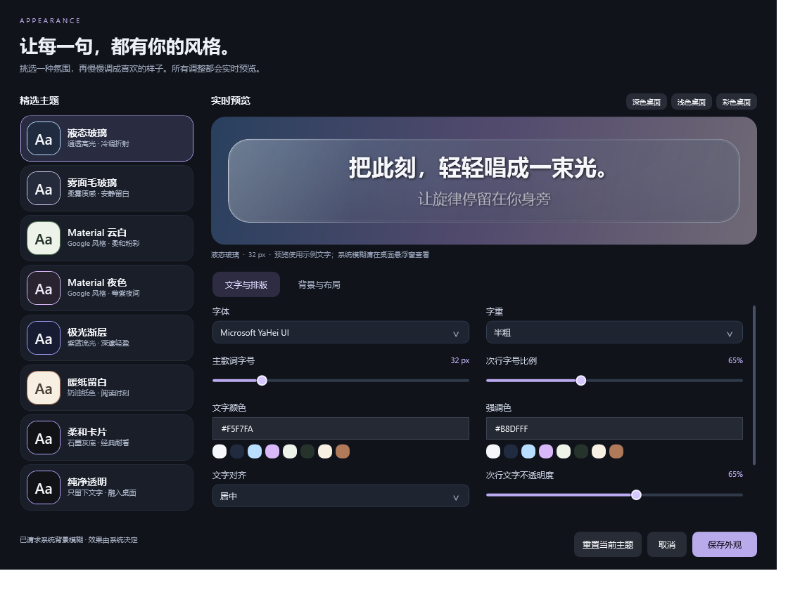
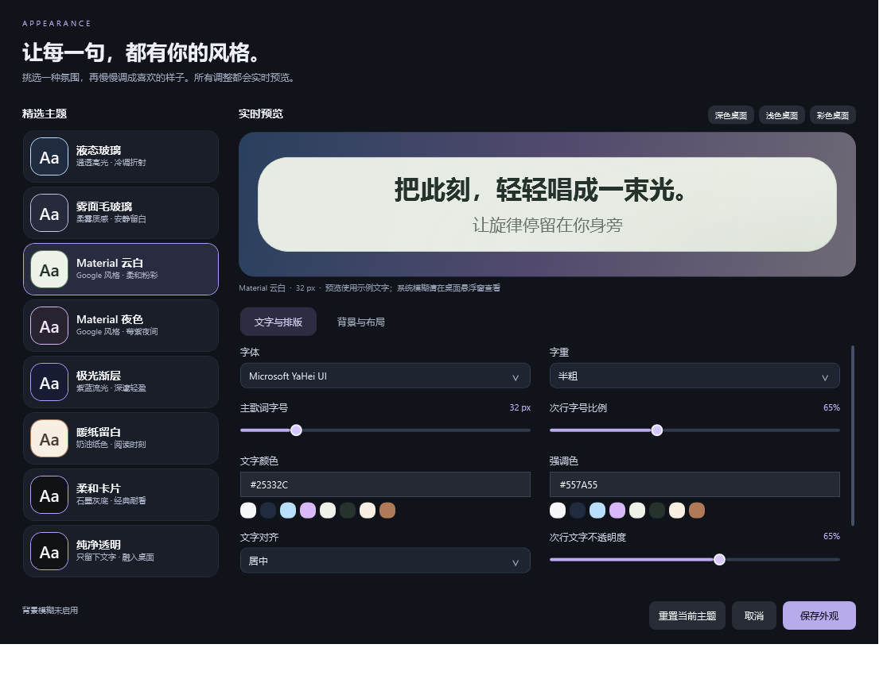

# 桌面歌词外观 · 0.3.0

当前 0.7.0 已重制玻璃材质，并加入编辑时拖动及字体悬停预览，请参阅[新的材质与外观指南](glass-materials.md)。本页保留历史版本说明。

2026-10-18。通过主窗口“外观”、桌面歌词悬停工具栏的“外观”，或托盘“桌面歌词外观…”进入。普通设置页也保留入口。

## 主题

| 主题 | 视觉特点 |
|---|---|
| 液态玻璃 | 冷调透明底、方向高光、细亮边缘、淡蓝色光晕；可请求系统背景模糊 |
| 雾面毛玻璃 | 柔雾底色、低强度高光和细边框；可请求系统背景模糊 |
| Material 云白 | Google Material 风格的灰绿粉彩、大圆角、深色文字 |
| Material 夜色 | 莓紫深底、柔和紫色强调和清晰浅色文字 |
| 极光渐层 | 紫、蓝、青的静态渐层 |
| 暖纸留白 | 奶油纸色、暖棕文字，适合阅读 |
| 柔和卡片 | 石墨灰背景，兼容旧版本偏好 |
| 纯净透明 | 仅显示文字，无卡片和系统模糊 |

选择主题会替换配色及材质参数，保留已选字体、主字号、字重、窗口宽度、单双行和对齐。更换主题后可以继续微调。“重置当前主题”恢复该主题的材质参数，同样保留这些排版选择。

## 自定义

- 字体：列出本机安装字体，可按字体名首字定位；中文字符使用系统字体回退。不下载或捆绑收费字体。
- 字号 18–96 px，字重四档，左右居中对齐；次行字号比例、不透明度、显示开关和行距独立设置。
- 文字色、背景色、强调色：快捷色板和 `#RRGGBB` 输入。未完成或错误的颜色不会应用，保存按钮会禁用并提示。
- 完全透明背景、背景不透明度、材质高光/渐层强度、系统模糊、边框、圆角、卡片留白和宽度。
- 文字阴影及强度。背景透明度不改变文字颜色或主行不透明度。
- 预览可切换深色、浅色和彩色桌面示意底色。预览使用自写示例句，与实际悬浮窗使用同一渲染控件；不会替换正在播放的歌词。

调整立即作用于预览和悬浮窗。“保存外观”写入原有本地设置；取消、Esc 或关闭面板会恢复打开面板前的外观。播放、联网和资料库设置不受外观取消操作回滚。旧版字体、字号及透明预设可以继续读取。

悬浮窗高度根据字号、内容与换行自动适应，最大 640 px；未锁定时保留拖动及宽度调整。工具栏仅在鼠标悬停时出现，锁定后隐藏，并保持托盘/快捷键解锁方式。

## Windows 材质边界

0.6.1 圆角修复：透明悬浮窗上的 Accent 模糊会填满矩形，忽略原生窗口区域与 WPF 圆角蒙版。圆角大于 0 时使用半透明玻璃材质，以保证四角透明和平滑边缘；圆角为 0 时仍按偏好请求系统模糊。模糊开关与透明度偏好均保留。当前验证见 [0.6.1 主题说明](ui-themes.md)，以下为 0.3.0 历史记录。

液态玻璃是本程序绘制的玻璃风格：分层透明色、高光、光晕与细边。它不包含 Apple 系统 Liquid Glass 的光学折射算法。系统背景模糊通过 Windows 10 的 Accent 兼容路径尝试启用；该路径不是 Windows 11 的 Mica 或 Desktop Acrylic。系统拒绝或关闭透明效果、启用高对比度时，会使用本程序的半透明材质，不改动系统设置。

本机 Windows 10 19045 对背景模糊请求返回成功。窗口截图接口出现 `FrameArrived timed out`，所以没有把原生模糊实景观感列为已通过。面板状态明确显示“已请求系统背景模糊 · 效果由系统决定”。透明主题与 0% 背景会主动关闭系统模糊。

参考：[Microsoft 系统背景类型及版本要求](https://learn.microsoft.com/en-us/windows/win32/api/dwmapi/ne-dwmapi-dwm_systembackdrop_type)、[SetWindowCompositionAttribute 的兼容性说明](https://learn.microsoft.com/en-us/windows/win32/dwm/setwindowcompositionattribute)。后者不是推荐的新应用材质接口，因此始终保留可关闭及降级路径。

## 验证

- 53 项自动测试通过，Core 29、Infrastructure 24；Release 构建 0 警告、0 错误。新增测试覆盖外观回滚、旧设置、非法参数归一化、全部主题落盘重读以及背景透明与文字独立。
- 独立 QA 数据目录运行实际 WPF 应用，检查八种主题、透明模式关闭模糊、取消恢复、保存重读，以及 96 px / 360 px 宽度时窗口边界。
- 运行时控件事件检查：安装字体切换、字体弹层、字号、字重、无效颜色禁止保存、有效颜色恢复保存、透明背景禁用模糊选项。详见 `screenshots-v030/appearance-check.json`。
- computer-use 在实际控件中把字号从 32 改为 44，控件树及实时预览说明同步更新；将颜色改为 `#BAD` 后保存禁用，改为 `#B8DFFF` 后恢复。Esc 关闭面板，设置恢复 32 px / 原配色。截图接口失败限制不影响这些可访问性读取与值设置检查。
- `screenshots-v030` 是实际 WPF 客户区渲染，含示例文字，不含桌面合成后的背景模糊效果。不能作为原生模糊、折射、性能或多屏/DPI 验收证据。

