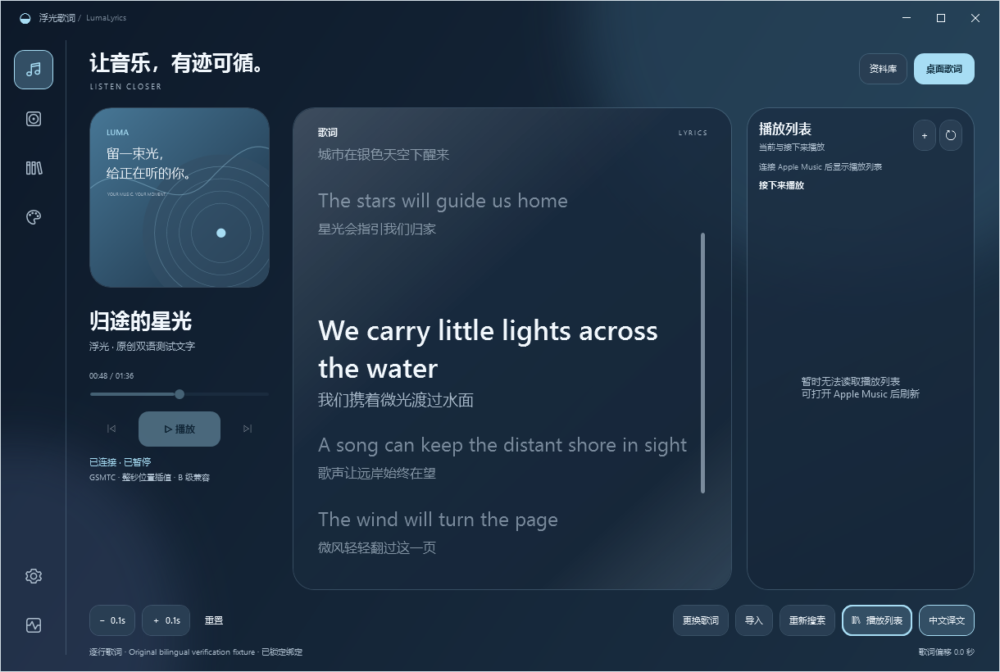
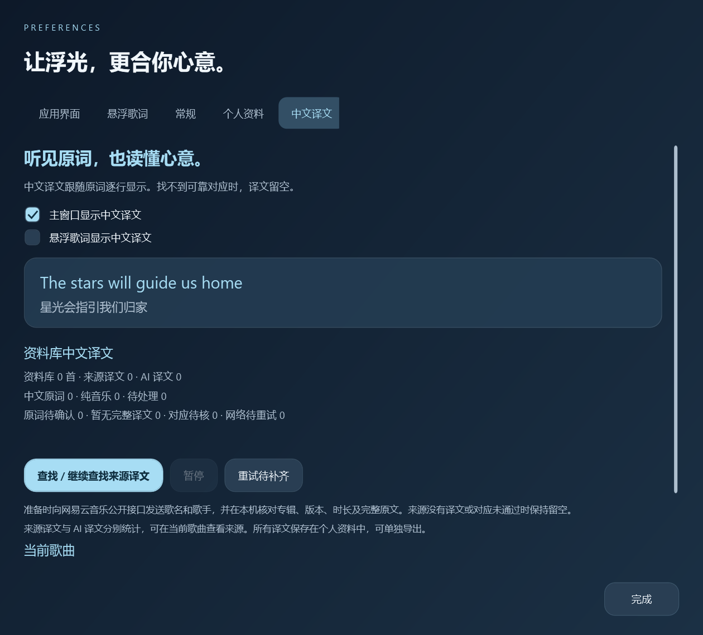

# 中文译文与资料库歌词

## 简体／繁体显示

在主界面底部校准按钮旁，或「设置 → 资料库与歌词 → 显示 → 歌词简繁显示」，选择「按原文」「简体中文」「繁体中文」。底部选择器只在当前原词包含中文（排除可识别的日韩原词），或主窗口／悬浮歌词任一中文译文开关开启时显示；外文歌词关闭译文后自动隐藏，保留已有选择。窄窗口自动分行。选择即时保存，并同步用于主窗口和悬浮歌词的中文原词、当前行、下一行及已有中文译文；默认按原文显示。

简繁转换通过内置 OpenCC 词组词典离线完成，只改变显示文字，不切换歌词来源或替换地区用语；保留原始文件、时间轴、歌曲偏移、原文哈希与译文配对。静态中文歌词也可切换；主窗口和悬浮歌词的译文开关仍各自独立。检测到日文假名或韩文时保留该首外文原词，单独转换它的中文译文。仅由汉字组成的日文无法可靠区分，需要时可选择「按原文」。

## 中文译文显示

在「设置 → 资料库与歌词 → 显示」分别开启主窗口和悬浮歌词的中文译文。两个开关即时保存，首次使用均关闭。原文下面显示较小的中文行，缺少对应时留空；间奏空行和已确认纯音乐保持留白。悬浮歌词的下一行仍是下一句原文，译文显示在各自原文下方。单行模式只保留当前原文与译文。

主界面右下角也可直接点击「中文译文」。高亮表示开启，与设置页双向同步，切换时保留手动浏览位置；仅改变主窗口，不改变悬浮译文或主题。0.16.4 的来源准备按原生资料库主清单确认成员，本地曲目表中的其他缓存记录不算资料库歌曲。

未锁定时，将指针移到悬浮歌词上，在上方工具栏点击「中文译文」即可切换悬浮译文。按钮高亮表示开启，与设置页同步，不改变主窗口的译文开关或主题。锁定后可用快捷键解锁再操作。0.10.1 按个人使用偏好移除可见的“待校对”标志；个人文件中的 AI 属性、来源和原始校对记录保留。





## 来源与校对状态

「查找 / 继续查找来源译文」读取本机完整 Apple Music 资料库，优先处理已有外文动态原词的歌曲。公开查询仅发送歌名和歌手，并在本机核对歌名、完整艺人、录音版本、专辑与时长；匹配后读取同一来源的原词及中文译文。服务拒绝、限流或连续失败时停止本轮，已保存内容保留，支持暂停、继续及重试待补齐项目。此操作遵守常规设置的联网开关，不会自动调用付费翻译服务。

来源译文采用网易云音乐已有社区译文。[公开歌词接口说明](https://github.com/ij96/163-lyrics-getter/wiki/NetEase-Music-API)和[来源项目的接口设计](https://github.com/hxabcd/lyrics-merge/blob/main/docs/superpowers/specs/2026-08-06-lyrics-merge-design.md)记录了原词、译文及元数据接口。程序不使用登录凭据、加密接口或音频下载。公开接口未承诺长期可用，服务限制时可以保留离线译文或手动导入。

程序比较完整原文顺序，将来源译文映射到当前原词的行号，使用当前歌曲既有的时间轴与偏移。不同录音、原文不一致、行数不足、时间对应歧义或占位内容不会自动显示。修改原词后，旧译文因原文 SHA-256 不同而失效；恢复相同原文可重新使用对应译文。个人手动原词与偏移不被覆盖，只有通过版本和时间轴检查的新原词才可自动导入。伴奏版本与人声原词矛盾时保持待确认，不据此推断为纯音乐。

**这些检查核对录音及逐行对应，不能证明语义逐句准确。** 设置页保留来源和准备进度，原始校对记录保存在个人文件中，不能将社区译文标记为 Apple Music 已逐首核对。

用户允许后，可以另行准备 AI 译稿。AI 译文与来源译文分别统计，设置页保留来源；0.10.1 不在歌词或设置中叠加待校对标志，存储中的 `Draft` 与 `Review` 原样保留。本次个人准备采用本地 [OPUS-MT 英语→中文](https://huggingface.co/Helsinki-NLP/opus-mt-en-zh)与 [NLLB-200](https://huggingface.co/facebook/nllb-200-distilled-600M) 量化模型，记录来源版本或权重哈希；罗马音日语另行准备 AI 译稿。不同模型及转译路径写入个人译文来源，异常输出先拦截并修订，无法确认的行留空。模型文件、个人原词及生成结果不进入软件安装包。下载模型后，个人歌词的推理在本机完成；这不代表语义已完成逐首校对，也不代表没有原词的其他歌曲已全部译完。

## 个人保存、修订和备份

译文单独保存在当前个人目录的 `translations.db`，不写入原来的 `lyrics.db`。准备队列、缺失原因与私人模型结果也留在个人目录。已保存译文可以离线显示；更新或分发软件不会夹带这些文件。

在「设置 → 资料库与歌词 → 歌曲」选择一首，在「更多操作…」中点击「导入所选歌曲中文 LRC…」，接收 UTF-8、与所选原词时间点逐行对应的译文。导入时检查所选目标、原词和译文修订是否变化，失败时保留已有译文。手动导入的译文不会被自动准备覆盖。中外文混合歌词不在原有中文行下面重复生成相同中文。

「设置 → 个人资料」导出时包含 `state/translations.db` 的一致快照和 `translations/*.json` 可读记录，保留原文哈希、行号、来源、AI 标记和状态。恢复到新的个人目录后继续使用。0.10.0 可恢复既有、不含译文的个人备份；包含译文的备份需用 0.10.0 或更新版本恢复。

## 个人译稿交换工具

以下命令在完整运行包中执行。导出文件是私人歌词内容，应保存在软件目录之外。导入前先在导出的每个 `Lines` 对象补齐 `Chinese`，保留 `Id`、`SourceHash`、曲目信息、`Original` 和 `GroupIndex`。这是经过校验的译稿交换入口；它本身不执行 AI 推理、不下载模型，也不上传原词。

```powershell
./runtime/dotnet.exe exec ./LumaLyrics.Probe.dll --translations "$env:LOCALAPPDATA/LumaLyrics"
./runtime/dotnet.exe exec ./LumaLyrics.Probe.dll --export-translation-drafts "$env:LOCALAPPDATA/LumaLyrics" "D:/个人资料/待翻译原词.json"
./runtime/dotnet.exe exec ./LumaLyrics.Probe.dll --import-translation-drafts "$env:LOCALAPPDATA/LumaLyrics" "D:/个人资料/已补齐译稿.json"
```

导入核对完整原词、逐行编号和当前哈希，跳过已存在的译文，不覆盖手动译文。仅有时间点、原词缺失或逐行记录不完整的译稿不能导入。如果某行确实无法确认，可保留完整原词行，将 `Chinese` 设为空字符串并填写 `UntranslatedReason`；该行保持留空，设置中显示实际覆盖行数，不能算作完整翻译。导入后保留个人存储中的 AI 来源与原始状态，可用中文 LRC 导入替换为个人修订版本。


## Apple Music 原词参考与已有配对（0.15.0）

本页新增「以 Apple Music 原词校对」入口，见[原词校对](lyrics-review.md)。比较结果是个人证据，不会把 OCR 字样直接覆盖到原词，也不会改变时间戳。

来源与个人原词只存在换行方式差别时，可将连续、完整对应的来源译句合并到既有原词组；逐个原文字符与顺序仍须一致，不猜测中文句子的分割位置。`--reconcile-translations` 可离线重新检查已经缓存的配对，仅填补缺失译文，保留已有手动与 AI 资料。完整文本与逐行对应通过仍不等于语义已由人工逐首核实。

## 本地 agent 批量翻译

在「设置 → 资料库与歌词」共用同一份确认过的歌曲清单。总览查看覆盖和后台预缓存，歌曲页选择处理范围，任务页查阅所有批次及单首／历史任务，显示页控制主窗口与悬浮译文。

1. 在「歌曲」搜索歌名、艺人或专辑，按缺原词、缺中文、部分译文、原词更新或「有中文译文」筛选。「有中文译文」包含当前完整及部分译文，覆盖来源译文、AI 译文和手动译文；与当前原词不再对应的记录继续在「原词已更新」中查看。Ctrl / Shift 多选，或点击「全选当前筛选」。筛选隐藏的已选项仍保留，操作前看“已选 N 首”；需要重新开始时先清空选择。选曲不要求先播放，播放切歌不会改变目标。
2. 点击「准备所选原词与译文」：缺可靠动态原词时先尝试补原词，再查现有来源译文；已有译文直接沿用，剩余可处理歌曲合并为一份本地 agent MD。「更多操作…」默认勾选优先查现有来源，可选同时补封面。没有可靠动态原词、静态或纯音乐会给出原因，不编造时间轴。
3. 若原词已备齐且想离线翻译，点击「直接生成本地任务」；仅需查询现成中文时用「更多操作… → 仅查现有中文」。准备遵守联网开关；关闭联网仍能为已有可靠动态原词生成 MD。
4. 从「更多操作…」打开／复制最近批量入口，或在「任务」选择具体批次并打开 MD。把这一份 `batch-task.md` 交给能读写本机的 agent，让它完整阅读并执行。无需逐首发送文件、查路径或操作数据库。
5. agent 按入口读取分块和每首任务，填写指定 JSON，逐首保存；默认每块 5 首，自动继续。应用运行时自动检查，退出后下次启动接收；也可点「刷新 / 接收结果」。显示仍取决于主窗口／悬浮独立开关。
6. 中断后，把同一份入口再次交给 agent 并说“继续未完成项”。它应复核 `agent-progress.json`、已提交文件与应用回执；没有回执只能称“已提交，待接收”。任务页保留每首状态及失败原因，缺失或篡改分块不会按标题猜成员。失败补缺项可重新检查，重译需再次明确选择。

已有译文不满意时，先按「有中文译文」筛选，选择歌曲，在「更多操作…」点击「重新生成翻译任务…」，确认本批歌曲数量后生成本地 agent 任务；到「任务」页复制翻译提示词交接。生成任务不会立即删除或替换现有译文。普通准备保留部分稿，部分稿不会显示为完整；要补做请明确重译。完整新稿通过检查后才替换，含未译行的替换稿需对所选一首明确采用；可恢复所选一首的上一版或取消所选任务。原词或当前译文变化时，晚到结果不会覆盖新版本。旧格式中多条原生记录共用同一个译文存储槽时，定向导入／恢复／替换会保守拦截并说明原因，避免影响未授权记录。

准备由当前个人资料会话持有。离开页面或关闭 Settings 只停止界面订阅，已启动工作继续；「更多操作… → 暂停准备」保留已完成内容。切换资料库来源、关闭联网或退出应用会取消在途准备，已导出的 agent 任务和已保存译文继续保留。

任务位于实际个人目录的 `translation-jobs` 与 `translation-batches`，agent只写指定结果及自己的进度，不写数据库。软件检查录音、原词哈希、完整逐组映射、格式、授权及预期修订；这些检查不等于人工语义校对，AI属性和来源始终保留。仅能聊天而不能读写本机的模型需要用户手工保存 JSON，无法自动落盘。软件不安装或调用翻译模型。

个人备份保存一致的译文数据库、当前译文、修订历史、任务和批次的可读记录。未最终提交的临时文件和 agent自行记录的进度不作为已接收成果备份；恢复后旧路径任务暂停，应重新生成入口。新版备份 manifest 为 2、译文库 schema 为 2，新版仍读取旧备份；旧软件不能打开新版资料，请保留可用备份并使用新版恢复到新目录。

可选只读校验及显式接收（使用运行包内 Microsoft host；路径参数均指实际个人目录和任务结果）：

```powershell
./runtime/dotnet.exe exec ./LumaLyrics.Probe.dll --validate-translation-job-result 'D:/个人资料' 'D:/个人资料/translation-jobs/实际任务ID/translation-result.json'
./runtime/dotnet.exe exec ./LumaLyrics.Probe.dll --import-translation-job-result 'D:/个人资料' 'D:/个人资料/translation-jobs/实际任务ID/translation-result.json'
```

基本流程不要求执行命令；不要原样执行上述示例路径。详细协议和实现步骤见[设计规格](superpowers/specs/2026-11-03-local-agent-chinese-translations.md)及[执行计划](superpowers/plans/2026-11-03-local-agent-chinese-translations.md)。

## 整合实现与验证

[整合设计](superpowers/specs/2026-11-03-library-lyrics-workspace.md)、[执行计划及交付记录](superpowers/plans/2026-11-03-library-lyrics-workspace.md)和[验证范围](verification-library-workspace/README.md)记录实现与限制。音乐浏览的歌曲「管理」及专辑「管理本专辑歌词」会携带原生身份进入同一个 Settings，不触发播放命令。

新增专辑未出现在歌曲页时，使用「总览 → 刷新资料库清单」。歌曲页的「刷新 / 接收结果」也会先同步成员，再接收 agent 结果。手动刷新独立于自动预缓存和联网查词开关；歌曲选择、筛选及已有译文仍保留。

## 一键复制本地 agent 提示词

在「设置 → 资料库与歌词 → 任务」选中一个批次或单首任务，点击主按钮「复制翻译提示词」，再粘贴给能读写本机文件的 agent。提示词包含当前所选说明的准确绝对路径、完整阅读、逐首保存、跨块续做和结果接收要求；无需自己编写交接话术。

复制时会重新核对登记任务和分块。说明缺失、成员不可核验或选中任务变化时，不复制另一个批次。已接收成果不重复制作；已取消、拒绝、冲突、过期或等待采用的部分稿会在提示词中明确排除，这些项目需先在应用中重新检查或确认。复制只写本机剪贴板，不发送给任何模型；由用户自行粘贴交接。

任务页左侧显示批次及实际接收数量，右侧显示逐首处理状态；窄窗口上下排列。总览的歌曲／原词／中文覆盖分开统计，歌曲页支持结构化曲目行、搜索、多选和隐藏选择保留，显示页分别管理主窗口与桌面歌词。
