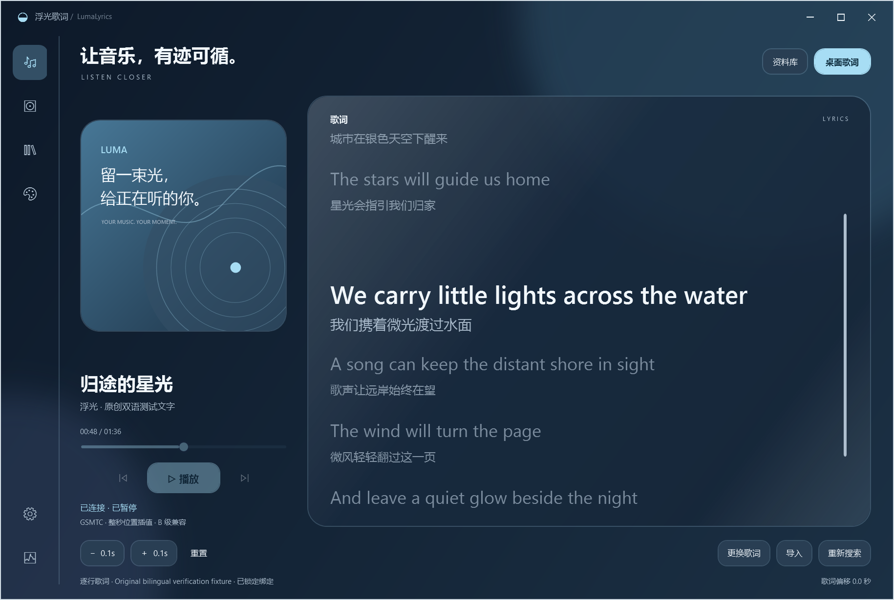
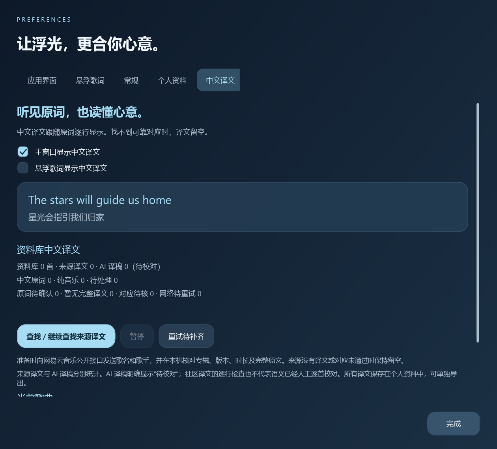

# 中文译文 · 0.10.0

在「设置 → 中文译文」分别开启主窗口和悬浮歌词的中文译文。两个开关即时保存，首次使用均关闭。原文下面显示较小的中文行，缺少对应时留空；间奏空行和已确认纯音乐保持留白。悬浮歌词的下一行仍是下一句原文，译文显示在各自原文下方。单行模式只保留当前原文与译文。





## 来源与校对状态

「查找 / 继续查找来源译文」读取本机完整 Apple Music 资料库，优先处理已有外文动态原词的歌曲。公开查询仅发送歌名和歌手，并在本机核对歌名、完整艺人、录音版本、专辑与时长；匹配后读取同一来源的原词及中文译文。服务拒绝、限流或连续失败时停止本轮，已保存内容保留，支持暂停、继续及重试待补齐项目。此操作遵守常规设置的联网开关，不会自动调用付费翻译服务。

来源译文采用网易云音乐已有社区译文。[公开歌词接口说明](https://github.com/ij96/163-lyrics-getter/wiki/NetEase-Music-API)和[来源项目的接口设计](https://github.com/hxabcd/lyrics-merge/blob/main/docs/superpowers/specs/2026-08-06-lyrics-merge-design.md)记录了原词、译文及元数据接口。程序不使用登录凭据、加密接口或音频下载。公开接口未承诺长期可用，服务限制时可以保留离线译文或手动导入。

程序比较完整原文顺序，将来源译文映射到当前原词的行号，使用当前歌曲既有的时间轴与偏移。不同录音、原文不一致、行数不足、时间对应歧义或占位内容不会自动显示。修改原词后，旧译文因原文 SHA-256 不同而失效；恢复相同原文可重新使用对应译文。个人手动原词与偏移不被覆盖，只有通过版本和时间轴检查的新原词才可自动导入。伴奏版本与人声原词矛盾时保持待确认，不据此推断为纯音乐。

**这些检查核对录音及逐行对应，不能证明语义逐句准确。** 设置页保留来源、校对状态和准备进度，不能将社区译文标记为 Apple Music 已逐首核对。

用户允许后，可以另行准备 AI 译稿。AI 译稿与来源译文分别统计；主窗口与悬浮歌词均明确显示 **“AI 译稿 · 待校对”**，不会冒充已校对翻译。本次个人准备采用本地 [OPUS-MT 英语→中文](https://huggingface.co/Helsinki-NLP/opus-mt-en-zh)与 [NLLB-200](https://huggingface.co/facebook/nllb-200-distilled-600M) 量化模型，记录来源版本或权重哈希；罗马音日语另行准备 AI 译稿。不同模型及转译路径写入个人译文来源，异常输出先拦截并修订，无法确认的行留空。模型文件、个人原词及生成结果不进入软件安装包。下载模型后，个人歌词的推理在本机完成；这不代表语义已完成逐首校对，也不代表没有原词的其他歌曲已全部译完。

## 个人保存、修订和备份

译文单独保存在当前个人目录的 `translations.db`，不写入原来的 `lyrics.db`。准备队列、缺失原因与私人模型结果也留在个人目录。已保存译文可以离线显示；更新或分发软件不会夹带这些文件。

「导入当前歌曲的中文 LRC」接收 UTF-8、与当前原词时间点逐行对应的译文。导入时检查当前曲目及原词是否变化，失败时保留已有译文。手动导入的译文不会被自动准备覆盖。中外文混合歌词不在原有中文行下面重复生成相同中文。

「设置 → 个人资料」导出时包含 `state/translations.db` 的一致快照和 `translations/*.json` 可读记录，保留原文哈希、行号、来源、AI 标记和状态。恢复到新的个人目录后继续使用。0.10.0 可恢复既有、不含译文的个人备份；包含译文的备份需用 0.10.0 或更新版本恢复。

## 个人译稿交换工具

以下命令在完整运行包中执行。导出文件是私人歌词内容，应保存在软件目录之外。导入前先在导出的每个 `Lines` 对象补齐 `Chinese`，保留 `Id`、`SourceHash`、曲目信息、`Original` 和 `GroupIndex`。这是经过校验的译稿交换入口；它本身不执行 AI 推理、不下载模型，也不上传原词。

```powershell
./runtime/dotnet.exe exec ./LumaLyrics.Probe.dll --translations "$env:LOCALAPPDATA/LumaLyrics"
./runtime/dotnet.exe exec ./LumaLyrics.Probe.dll --export-translation-drafts "$env:LOCALAPPDATA/LumaLyrics" "D:/个人资料/待翻译原词.json"
./runtime/dotnet.exe exec ./LumaLyrics.Probe.dll --import-translation-drafts "$env:LOCALAPPDATA/LumaLyrics" "D:/个人资料/已补齐译稿.json"
```

导入核对完整原词、逐行编号和当前哈希，跳过已存在的译文，不覆盖手动译文。仅有时间点、原词缺失或逐行记录不完整的译稿不能导入。如果某行确实无法确认，可保留完整原词行，将 `Chinese` 设为空字符串并填写 `UntranslatedReason`；该行保持留空，设置中显示实际覆盖行数，不能算作完整翻译。导入后统一保留 AI 待校对标记，可用中文 LRC 导入替换为个人修订版本。
