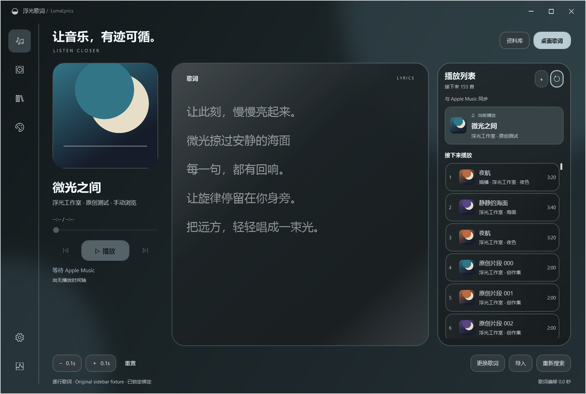
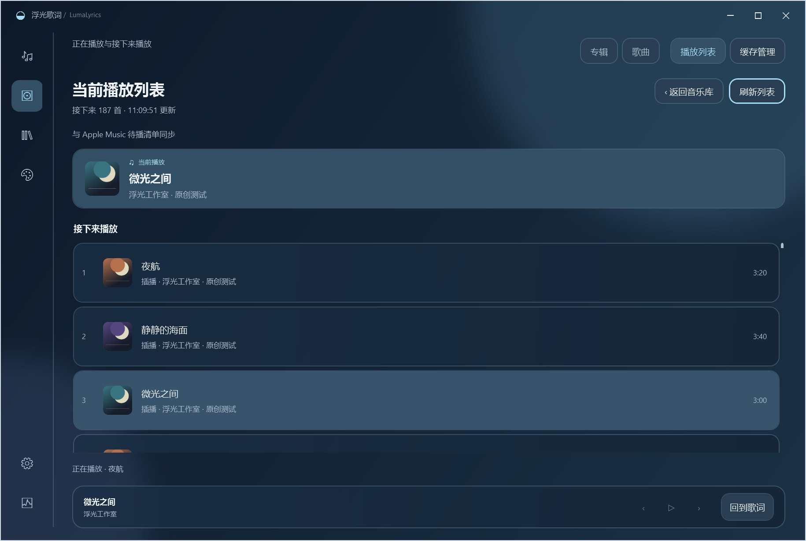
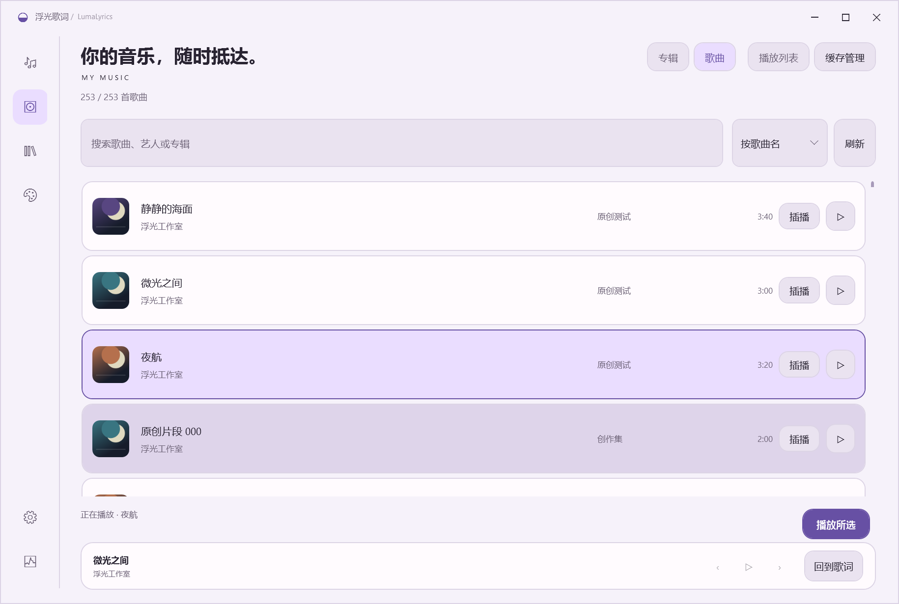
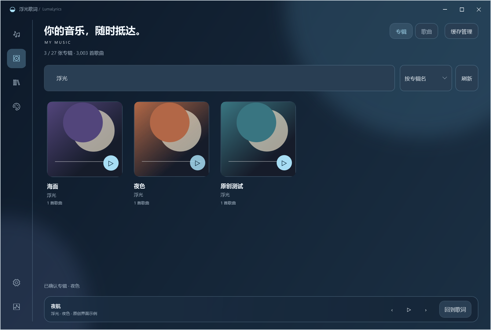
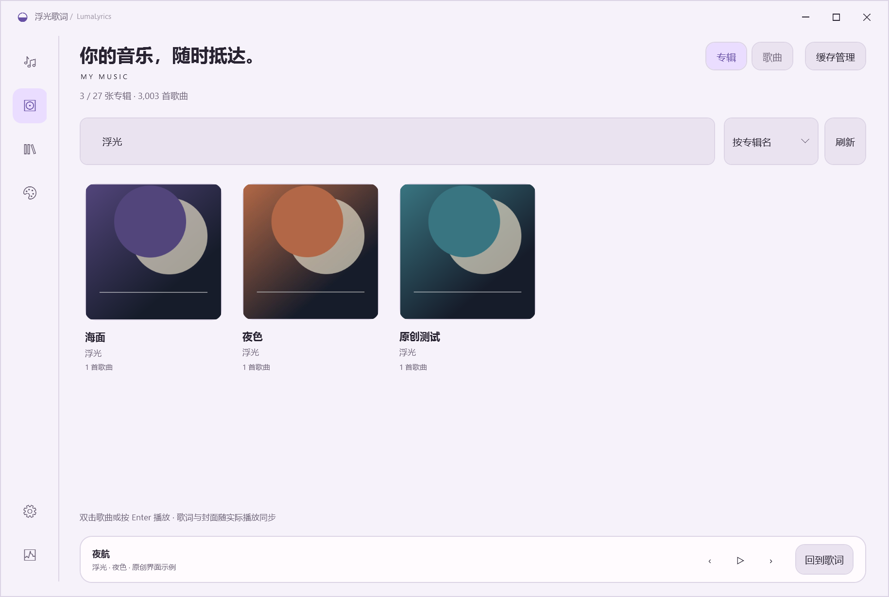

# 专辑音乐库、播放列表与插播 · 0.13.0

## 播放页面的右侧列表

播放/歌词页面右侧直接显示「播放列表」，当前歌曲单独突出，下面按 Apple Music 实际顺序显示接下来播放的歌曲和手动插播标记。显示已有个人封面，缺失时保留占位。点刷新图标更新，点「＋」打开音乐库选歌。

页面可见时约每 15 秒刷新，切歌后及时更新；切到音乐库、隐藏或最小化浮光时停止读取。正在选曲时暂缓列表读取，完成后再更新，避免后台列表刷新妨碍播放确认。曲目较长时省略显示，悬停可看完整歌名、艺人、专辑和时长。三种主题与窗口缩放均适配，窄窗口将左侧歌曲信息和歌词上下排列，播放列表仍留在右侧。

## 慢响应与最小化

选曲后，浮光等待 Apple Music 的本地筛选、所选录音和专辑界面就绪，实际播放命令只发送一次。原生选歌有 60 秒上限，整张专辑为 75 秒；命令发出后，媒体确认最多等待 60 秒。单次媒体读取超过 5 秒会继续等待同一个读取，不立即判定选歌失败；临时读取错误会在总时限内重试。只有收到新的 Apple Music 状态、录音一致且确实正在播放才确认成功。

成功后自动最小化 Apple Music，并返回浮光。原来已经最小化的客户端会先等待窗口恢复可用，再选曲，确认后重新最小化；原来可见的客户端也会在成功后最小化。插播则在原生队列确认后最小化，当前歌曲不中断。较早请求取消或稍晚完成时，不会抢焦点或最小化较新操作。未获确认的请求显示原因，歌词始终跟随实际播放。

Apple Music 选歌期间仍可能短暂显示窗口；本版调整完成时机和成功后的窗口状态，没有将无障碍操作变为完全后台点播。队列读取本身不会恢复或激活原生窗口。

## 当前播放列表

在音乐库右上角点「播放列表」，即可查看 Apple Music 当前歌曲和「接下来播放」。清单直接读取原生队列：手动插播在前，专辑的后续曲目在后，保留原生顺序和重复歌曲，不使用浮光歌曲列表的浏览排序推算队列。封面使用已有个人缓存，缺失时保留占位。

点「刷新列表」读取最新状态；页面可见时约每 15 秒同步一次，当前录音变化和插播结束后也会更新。隐藏或离开页面时停止轮询并取消未完成读取。返回音乐库保留原来专辑、搜索、歌曲选择和滚动位置，也可以直接点「专辑」或「歌曲」。主题仍在设置中选择。

歌曲行的「插播」会让所选录音排到当前歌曲之后，当前歌曲继续播放。连续点选不同歌曲会逐个加入；Apple Music 将最近插入的放到最前面。原有「▷」继续表示立即播放，两种操作分开。键盘可聚焦插播按钮，按 Enter 或空格；在歌曲行按 Enter 仍是立即播放。

插播同样核对歌名、艺人、专辑和可用时长，通过唯一的资料库录音调用原生「插播」，再等待实际待播清单更新。只重试读取确认，不重复发送插播命令；目标已经位于下一首时，还需确认其队列出现次数增加。若已发送但暂无法确认，界面如实提示并允许刷新查看。

队列读取支持原生虚拟化列表，保留自动连播实际暴露的曲目，不预测尚未生成的推荐。单次读取最多处理 2,000 项并有时间限制；信息不完整时显示「部分列表」，不会把可见几首冒充完整队列。客户端未打开、版本接口不同或读取失败时显示原因，与确实没有下一首的空队列分别处理。

在当前中文客户端已实测最小化读取，保持最小化、队列面板及历史记录选择。读取本身不会主动恢复原生窗口；插播和立即播放仍沿用下文的原生选歌方式，可能短暂显示 Apple Music。实际队列继续由 Apple Music 保存，浮光不另建会与它分叉的持久队列。现场诊断与个人歌曲元数据不进入软件包。

## 专辑浏览与播放

主界面左侧的唱片图标打开「音乐库」，默认按专辑封面排列。它读取本机 Apple Music 已同步的完整歌曲清单，不要求歌词或封面先下载完成。点击专辑进入曲目页，再双击歌曲、按 Enter 或点击播放按钮。键盘可用 Tab 聚焦专辑卡片，Enter 打开。底部保留上一首、播放/暂停、下一首和「回到歌词」，原有歌词与封面队列位于「缓存管理」。

专辑封面右下角的圆形播放按钮可直接播放整张专辑，详情页也有「播放专辑」按钮。卡片的打开与播放分别操作，支持 Tab 聚焦及键盘确认。专辑播放使用 Apple Music 的原生曲序和队列，下一首继续播放该专辑；浮光的曲目列表按所选排序浏览。关闭浮光不会清除 Apple Music 中已建立的专辑队列。

专辑页可按专辑名或艺人排序，搜索同时覆盖专辑、艺人和其中的歌名。进入专辑后搜索只筛选该专辑的歌曲，默认按歌曲名排序，可切换艺人或专辑排序；当前未从未经确认的数据库字段猜测原版曲序。「所有专辑」恢复上次的专辑搜索和滚动位置；「歌曲」切换到全库歌曲列表，两种视图分别保留搜索与排序选择。点击当前视图按钮也会保留搜索文字。

分组始终保留来源、明确的专辑名和已有的专辑艺人，再使用本机封面索引中存在的候选持久标识；候选标识可能被不同专辑共用，不能覆盖冲突的专辑名或专辑艺人。没有索引确认的标识时，使用来源、专辑名和专辑艺人，专辑艺人缺失时使用歌曲艺人。不同来源与不同专辑名分别排列，有可用标识或专辑艺人的合辑会保留为一张。缺失专辑名的歌曲分别显示为「未命名专辑」，不虚构共同专辑。纯缓存模式缺少专辑艺人时采用保守分组，重新读取本机资料库可取得更完整的身份信息。

## 播放与歌词

请先打开并登录 Windows 原生 Apple Music。浮光调用原生资料库的本地歌曲筛选与播放命令，核对歌名、艺人、专辑和可用时长；相同元数据存在多个结果时提示确认版本。播放后再核对真实媒体会话，确认实际歌曲及播放状态后才显示「正在播放」。歌词和当前封面始终跟随实际播放内容。

0.11.0 修复了本地筛选未打开时误选左侧全局搜索框的问题。现在只操作歌曲列表的本地筛选，等待筛选更新后重新查找对应录音，全局搜索保持原样。原生连接尚未建立时会尝试重连，播放确认使用发出命令之后的媒体状态。

专辑播放先核对一首明确的资料库录音，通过原生「在资料库中显示专辑」进入所属专辑，再检查专辑标题、艺人和可见曲目，使用该专辑的播放按钮。原生首曲也必须能明确对应，随后实际媒体会话确认首曲开始播放。信息不足或版本不明确时保留当前播放并显示原因。单曲与专辑请求互相取消较早的请求，旧请求不会覆盖新状态。

Apple Music 可以放在后台或最小化。选歌时可能短暂恢复原生窗口，并还原原有的本地筛选文字；0.13.0 起在实际播放确认成功后统一最小化，再返回浮光。连续选择歌曲会取消较早的请求，避免旧请求的结果覆盖当前状态。已发出的播放命令无法撤回，后一次请求会继续切换到最后选择的歌曲。

**完全后台点播暂缓。** 在当前中文 Apple Music 1.1540.23042.0 上，去掉窗口恢复后，可在最小化状态筛选歌曲，但原生歌曲菜单没有可用的播放命令，真实媒体会话也未切换；窗口可见时，同一原生命令可以播放，但客户端会自行取得前台。试验同时观察窗口是否恢复、是否取得前台及实际歌曲与播放状态。该试验已撤回，本版保留原来的可靠点播方式；结果说明当前适配无法保证不弹窗，并不代表所有未来接口都不可行。[微软无障碍调用说明](https://learn.microsoft.com/en-us/dotnet/api/system.windows.automation.invokepattern.invoke?view=windowsdesktop-9.0)也要求依赖控件提供者实现相应行为。

接口不可用、客户端未打开、录音不明确或播放未获确认时，音乐库显示具体提示；可稍后重试。此适配依赖原生界面的无障碍接口，Apple Music 更新后可能需要调整。当前中文客户端的真实播放验证与完整兼容性边界另见本页的验证记录。没有可靠歌词的歌曲仍按现有缺失状态显示；只有已确认纯音乐才留空。

## 封面与个人资料

列表通过资料库来源与歌曲持久标识关联已有个人封面。专辑卡片采用 360 像素缩略图，歌曲行采用 96 像素；只为实际生成的卡片或歌曲行解码，每种缓存最多 128 项，缺失或损坏封面显示占位。专辑网格按行虚拟化并随窗口宽度调整列数，不创建全库卡片。浏览本身不会启动新的下载或修改手动歌词绑定。个人歌词、原始封面、数据库、设置和现场测试记录继续保存在程序目录之外，软件 ZIP 不携带这些文件。

0.9.1 修复了封面导入后专辑仍为空的问题：旧版只在首次进入时读取清单，后来导入的封面不会传回已打开的页面。现在封面导入进度变化会合并触发可见页面的更新，持续导入时最多每秒刷新一次；隐藏页面暂缓处理，重新进入时读取最新清单。自动更新保留搜索、排序、所选专辑、歌曲选择、滚动位置和播放提示，读取暂时失败时保留现有页面并等待下一次更新或重新进入。刷新后释放旧缩略图与缺失结果；同一路径换图也会使用新像素。

验证使用与个人缓存相同的 `.img` 扩展名，内容分别为原创 PNG/JPEG；封面仍按图片实际编码解码。没有重新下载、复制到软件包或改动原始个人封面。

## 拖动与主题

移动悬浮歌词时暂停桌面像素采样，圆角形状不变时复用原生区域和合成几何，仅同步背景层位置；拖动结束后更新文字明暗。受控的 32 步移动测试中，单步处理耗时中位数从 44.7 ms 降至 2.6 ms，移动期间桌面读回及几何重建均为零。这是该测试中的处理耗时，不代表所有设备的实际帧率。

三个主应用主题与八个悬浮主题独立。应用主题继续在设置中选择，悬浮主题和每个主题的自定义记忆仍位于独立外观编辑器。

## 验证记录

原创 3003 首歌曲及 3003 张专辑测试清单用于验证分组、专辑卡片与详情、搜索、返回、滚动位置、刷新后保持所选专辑、三种主题、正方形封面、按行虚拟化、360/96 像素缩略图、缓存上限、缺失/损坏图片、行按钮/Enter/双击、取消旧播放、实际歌曲高亮、缓存入口、播放控制、空库、读取失败、重新进入及 820/980/1220 宽度。完整结果见 [UI 检查](screenshots-ui-v090/ui-check.json)。

最新单元测试与源码/运行包界面检查见 [0.13.0 验证记录](screenshots-ui-v0130/README.md)。新增右侧列表、慢响应确认、延迟控件、窗口归属、成功后最小化及三种主题布局检查；原有原生队列、插播、筛选隔离、专辑播放、封面、悬浮及个人资料检查继续回归。

封面回归先在旧代码中复现「重新进入仍不显示已导入封面」，再验证导入进度合并、可见页自动更新、隐藏页延后、完成后重试、读取失败时保留页面、查询/选曲/滚动/播放状态保留及同路径换图。另用真实个人缓存的独立副本与 0.9.1 包内程序集，在应用自身的 WPF 渲染中验证「缺图 → 恢复文件 → 外部进度触发自动补齐」，专辑卡片、详情与歌曲行均能显示。该过程不修改原始个人库，个人封面和现场图片不进入 GitHub 或软件 ZIP。

真实中文 Apple Music 1.1540.23042.0 已完成从浮光点击歌曲、核对录音、原生实际播放及当前歌曲跟随的验证，也确认了原生客户端最小化时可从浮光点播。0.9.0 运行包另行完成真实资料库专辑分组、专辑封面进入曲目、专辑内搜索、实际播放及暂停的验证；同艺人的不同专辑保持分别排列。现场曲目元数据与截图保留在忽略的本机测试目录，不提交 GitHub。此结果不等同于全曲库、所有客户端版本、多显示器或长时间稳定性验收。

0.11.0 在同一已安装客户端重现了原有失败，并在修复后确认两首不同歌曲真实播放；另验证一张多曲专辑从原生第一首开始，下一首进入原生第二首且仍属所选专辑。测试后恢复原先的歌曲与暂停状态；媒体会话不支持恢复精确播放位置。现场报告留在忽略目录，软件包仅含原创界面素材。

0.12.0 真实插播及同一录音连续插播均通过原生队列确认，当前录音、暂停状态和原有后续曲目保留。测试后核对整个现场队列与已知测试状态一致，仅清除本次新增的手动测试项，再验证原队列完整恢复。另实测最小化读取、历史记录选择及面板状态恢复。[不含个人元数据的摘要](screenshots-ui-v0120/live-queue-check.json)。

0.13.0 在真实客户端人为将媒体确认延迟 12 秒，验证短超时后继续等待、确认前保持原生窗口可见、确认成功后最小化。分别验证原先最小化和原先可见的客户端，单曲和原生专辑均确认成功。测试后恢复原歌曲、完整待播顺序及暂停状态；精确进度受媒体会话能力限制。[不含个人元数据的摘要](screenshots-ui-v0130/live-handoff-check.json)。
