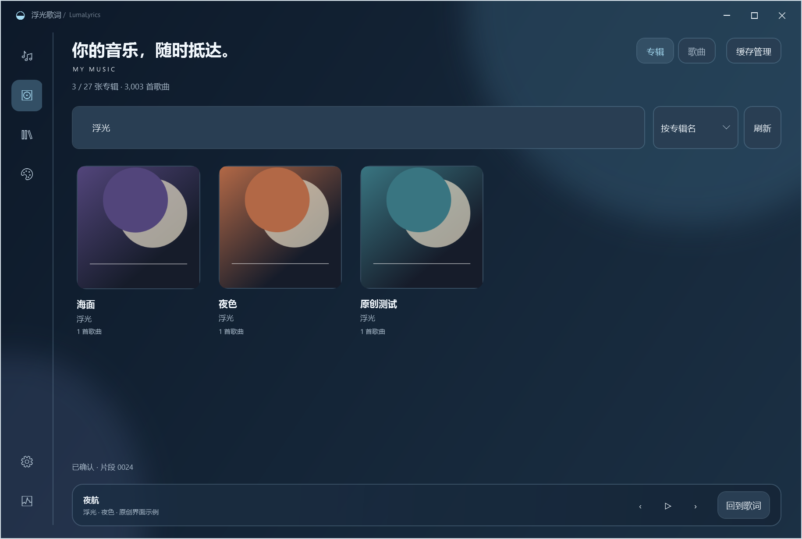

# 专辑音乐库与播放 · 0.9.1

主界面左侧的唱片图标打开「音乐库」，默认按专辑封面排列。它读取本机 Apple Music 已同步的完整歌曲清单，不要求歌词或封面先下载完成。点击专辑进入曲目页，再双击歌曲、按 Enter 或点击播放按钮。键盘可用 Tab 聚焦专辑卡片，Enter 打开。底部保留上一首、播放/暂停、下一首和「回到歌词」，原有歌词与封面队列位于「缓存管理」。

专辑页可按专辑名或艺人排序，搜索同时覆盖专辑、艺人和其中的歌名。进入专辑后搜索只筛选该专辑的歌曲，默认按歌曲名排序，可切换艺人或专辑排序；当前未从未经确认的数据库字段猜测原版曲序。「所有专辑」恢复上次的专辑搜索和滚动位置；「歌曲」切换到全库歌曲列表，两种视图分别保留搜索与排序选择。点击当前视图按钮也会保留搜索文字。

分组始终保留来源、明确的专辑名和已有的专辑艺人，再使用本机封面索引中存在的候选持久标识；候选标识可能被不同专辑共用，不能覆盖冲突的专辑名或专辑艺人。没有索引确认的标识时，使用来源、专辑名和专辑艺人，专辑艺人缺失时使用歌曲艺人。不同来源与不同专辑名分别排列，有可用标识或专辑艺人的合辑会保留为一张。缺失专辑名的歌曲分别显示为「未命名专辑」，不虚构共同专辑。纯缓存模式缺少专辑艺人时采用保守分组，重新读取本机资料库可取得更完整的身份信息。

## 播放与歌词

请先打开并登录 Windows 原生 Apple Music。浮光调用原生资料库的本地歌曲筛选与播放命令，核对歌名、艺人、专辑和可用时长；相同元数据存在多个结果时提示确认版本。播放后再核对真实媒体会话，确认实际歌曲及播放状态后才显示「正在播放」。歌词和当前封面始终跟随实际播放内容。

Apple Music 可以放在后台或最小化。选歌时可能短暂恢复原生窗口，完成后恢复原来的最小化状态，并还原原有的本地筛选文字。连续选择歌曲会取消较早的请求，避免旧请求的结果覆盖当前状态。已发出的播放命令无法撤回，后一次请求会继续切换到最后选择的歌曲。

**完全后台点播暂缓。** 在当前中文 Apple Music 1.1540.23042.0 上，去掉窗口恢复后，可在最小化状态筛选歌曲，但原生歌曲菜单没有可用的播放命令，真实媒体会话也未切换；窗口可见时，同一原生命令可以播放，但客户端会自行取得前台。试验同时观察窗口是否恢复、是否取得前台及实际歌曲与播放状态。该试验已撤回，本版保留原来的可靠点播方式；结果说明当前适配无法保证不弹窗，并不代表所有未来接口都不可行。[微软无障碍调用说明](https://learn.microsoft.com/en-us/dotnet/api/system.windows.automation.invokepattern.invoke?view=windowsdesktop-9.0)也要求依赖控件提供者实现相应行为。

接口不可用、客户端未打开、录音不明确或播放未获确认时，音乐库显示具体提示；可稍后重试。此适配依赖原生界面的无障碍接口，Apple Music 更新后可能需要调整。当前中文客户端的真实播放验证与完整兼容性边界另见本页的验证记录。没有可靠歌词的歌曲仍按现有缺失状态显示；只有已确认纯音乐才留空。

## 封面与个人资料

列表通过资料库来源与歌曲持久标识关联已有个人封面。专辑卡片采用 360 像素缩略图，歌曲行采用 96 像素；只为实际生成的卡片或歌曲行解码，每种缓存最多 128 项，缺失或损坏封面显示占位。专辑网格按行虚拟化并随窗口宽度调整列数，不创建全库卡片。浏览本身不会启动新的下载或修改手动歌词绑定。个人歌词、原始封面、数据库、设置和现场测试记录继续保存在程序目录之外，软件 ZIP 不携带这些文件。

0.9.1 修复了封面导入后专辑仍为空的问题：旧版只在首次进入时读取清单，后来导入的封面不会传回已打开的页面。现在封面导入进度变化会合并触发可见页面的更新，持续导入时最多每秒刷新一次；隐藏页面暂缓处理，重新进入时读取最新清单。自动更新保留搜索、排序、所选专辑、歌曲选择、滚动位置和播放提示，读取暂时失败时保留现有页面并等待下一次更新或重新进入。刷新后释放旧缩略图与缺失结果；同一路径换图也会使用新像素。

验证使用与个人缓存相同的 `.img` 扩展名，内容分别为原创 PNG/JPEG；封面仍按图片实际编码解码。没有重新下载、复制到软件包或改动原始个人封面。

## 拖动与主题

移动悬浮歌词时暂停桌面像素采样，圆角形状不变时复用原生区域和合成几何，仅同步背景层位置；拖动结束后更新文字明暗。受控的 32 步移动测试中，单步处理耗时中位数从 44.7 ms 降至 2.6 ms，移动期间桌面读回及几何重建均为零。这是该测试中的处理耗时，不代表所有设备的实际帧率。

三个主应用主题与八个悬浮主题独立。应用主题继续在设置中选择，悬浮主题和每个主题的自定义记忆仍位于独立外观编辑器。

## 验证记录

原创 3003 首歌曲及 3003 张专辑测试清单用于验证分组、专辑卡片与详情、搜索、返回、滚动位置、刷新后保持所选专辑、三种主题、正方形封面、按行虚拟化、360/96 像素缩略图、缓存上限、缺失/损坏图片、行按钮/Enter/双击、取消旧播放、实际歌曲高亮、缓存入口、播放控制、空库、读取失败、重新进入及 820/980/1220 宽度。完整结果见 [UI 检查](screenshots-ui-v090/ui-check.json)。

147 项单元测试通过，源码与自包含运行包分别通过 371 项 WPF 检查；其中包含 16 项封面更新、28 项专辑浏览、原有 29 项音乐库和 54 项悬浮主题隔离检查。最新结果见 [0.9.1 UI 检查](screenshots-ui-v091/ui-check.json)，Release 编译无警告。

封面回归先在旧代码中复现「重新进入仍不显示已导入封面」，再验证导入进度合并、可见页自动更新、隐藏页延后、完成后重试、读取失败时保留页面、查询/选曲/滚动/播放状态保留及同路径换图。另用真实个人缓存的独立副本与 0.9.1 包内程序集，在应用自身的 WPF 渲染中验证「缺图 → 恢复文件 → 外部进度触发自动补齐」，专辑卡片、详情与歌曲行均能显示。该过程不修改原始个人库，个人封面和现场图片不进入 GitHub 或软件 ZIP。

真实中文 Apple Music 1.1540.23042.0 已完成从浮光点击歌曲、核对录音、原生实际播放及当前歌曲跟随的验证，也确认了原生客户端最小化时可从浮光点播。0.9.0 运行包另行完成真实资料库专辑分组、专辑封面进入曲目、专辑内搜索、实际播放及暂停的验证；同艺人的不同专辑保持分别排列。现场曲目元数据与截图保留在忽略的本机测试目录，不提交 GitHub。此结果不等同于全曲库、所有客户端版本、多显示器或长时间稳定性验收。
