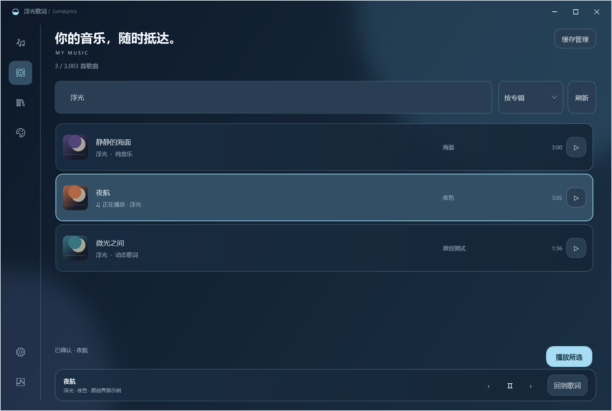

# 内置音乐库与悬浮拖动 · 0.8.0

主界面左侧的唱片图标打开「音乐库」。它读取本机 Apple Music 已同步的完整歌曲清单，不要求歌词或封面先下载完成。输入歌名、艺人或专辑可组合搜索，右侧选择排序；双击歌曲、按 Enter 或点击播放按钮即可选歌。底部保留上一首、播放/暂停、下一首和「回到歌词」。原有歌词与封面队列位于「缓存管理」。

## 播放与歌词

请先打开并登录 Windows 原生 Apple Music。浮光调用原生资料库的本地歌曲筛选与播放命令，核对歌名、艺人、专辑和可用时长；相同元数据存在多个结果时提示确认版本。播放后再核对真实媒体会话，确认实际歌曲及播放状态后才显示「正在播放」。歌词和当前封面始终跟随实际播放内容。

Apple Music 可以放在后台或最小化。选歌时可能短暂恢复原生窗口，完成后恢复原来的最小化状态，并还原原有的本地筛选文字。连续选择歌曲会取消较早的请求，避免旧请求的结果覆盖当前状态。已发出的播放命令无法撤回，后一次请求会继续切换到最后选择的歌曲。

接口不可用、客户端未打开、录音不明确或播放未获确认时，音乐库显示具体提示；可稍后重试。此适配依赖原生界面的无障碍接口，Apple Music 更新后可能需要调整。当前中文客户端的真实播放验证与完整兼容性边界另见本页的验证记录。没有可靠歌词的歌曲仍按现有缺失状态显示；只有已确认纯音乐才留空。

## 封面与个人资料

列表通过资料库来源与歌曲持久标识关联已有个人封面；只在可见行解码缩略图，复用列表容器，并限制缩略图缓存数量。浏览本身不会启动新的下载或修改手动歌词绑定。个人歌词、原始封面、数据库、设置和现场测试记录继续保存在程序目录之外，软件 ZIP 不携带这些文件。

## 拖动与主题

移动悬浮歌词时暂停桌面像素采样，圆角形状不变时复用原生区域和合成几何，仅同步背景层位置；拖动结束后更新文字明暗。受控的 32 步移动测试中，单步处理耗时中位数从 44.7 ms 降至 2.6 ms，移动期间桌面读回及几何重建均为零。这是该测试中的处理耗时，不代表所有设备的实际帧率。

三个主应用主题与八个悬浮主题独立。应用主题继续在设置中选择，悬浮主题和每个主题的自定义记忆仍位于独立外观编辑器。

## 验证记录

原创 3003 首测试清单用于验证搜索、排序、容器虚拟化、96 像素缩略图、缓存上限、损坏图片、行按钮/Enter/双击、取消旧播放、实际歌曲高亮、缓存入口、播放控制、空库、读取失败、刷新恢复、重新进入及 820/980/1220 宽度。完整结果见 [UI 检查](screenshots-ui-v080/ui-check.json)。

138 项单元测试通过，源码与自包含运行包均通过 327 项 WPF 检查，其中音乐库 29 项、悬浮主题隔离 54 项。

真实中文 Apple Music 1.1540.23042.0 已完成从浮光点击歌曲、核对录音、原生实际播放及当前歌曲跟随的验证，也确认了原生客户端最小化时可从浮光点播。现场曲目元数据与截图保留在忽略的本机测试目录，不提交 GitHub。此结果不等同于全曲库、所有客户端版本、多显示器或长时间稳定性验收。
