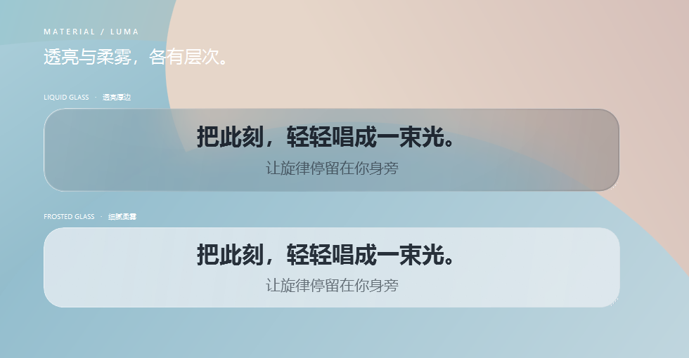

# 0.16.1 悬浮玻璃背景修复

修复液态玻璃和毛玻璃背景偶发变黑，以及隐藏再显示后背景层被遮住的问题。玻璃宿主使用无重定向位图的原生窗口，原生分层 alpha 固定为 255，浮点透明度由合成视觉层处理。宿主与歌词窗口共享 owner，背景仍在清晰的 WPF 文字下方。

玻璃专项检查每种材质的初次显示与往返切换，每组连续采样四帧，取最差帧参与验收；所有帧均须满足原来的方差比 `< 0.35` 与色差 `< 24`，圆角外像素差仍须 `≤ 3`。

淡出检查比较实际画面在完整、四分之一和零透明度时的细节方差，并核对场景颜色、合成层透明度与固定的原生 alpha。锁定状态使用系统 `WindowFromPoint` 验证输入命中下层原创场景；显示、隐藏与淡出不能激活歌词或玻璃窗口。近零背景强度检查直接核对浮点合成透明度。

本机为 Windows 10 22H2，100% 缩放。Release 构建零警告、零错误；280 项单元测试通过。[源码完整 WPF 检查](ui-check.json)与[自包含运行包检查](ui-check.packaged.json)均为 **715/715**，其中玻璃专项 62 项；原有的主应用、个人资料、独立外观、队列和翻译界面继续回归。[0.16.0 的原始失败报告](../screenshots-ui-v0160/README.md)保持原样。

运行包使用随包 Microsoft host 验证，SDK 列表为空；[运行包程序集 SHA-256](binary-checksums.json)记录五个项目程序集。最终软件目录通过分发边界检查，2 个软件样例与 32 个私人文件拒绝样例通过。



| 原生背景层画面 | 完整强度 | 四分之一强度 | 零强度 |
| --- | --- | --- | --- |
| 液态玻璃 | [完整](glass-liquid-full.png) | [四分之一](glass-liquid-quarter.png) | [原始背景](glass-liquid-clear.png) |
| 毛玻璃 | [完整](glass-frost-full.png) | [四分之一](glass-frost-quarter.png) | [原始背景](glass-frost-clear.png) |

[液态玻璃与文字](overlay-liquid-native.png) · [毛玻璃与文字](overlay-frost-native.png)。背景强度测量图暂时隐藏文字层；原生文字图与综合预览显示实际歌词，所有图均使用原创场景。

在完整解压的运行包目录中，可单独复验玻璃专项。数据与报告写入软件之外的新隔离目录：

```powershell
$glassRoot = Join-Path $env:LOCALAPPDATA ("LumaLyrics-Checks\" + [guid]::NewGuid())
New-Item -ItemType Directory -Path "$glassRoot\data","$glassRoot\report" -Force | Out-Null
& .\runtime\dotnet.exe .\LumaLyrics.dll --data-dir "$glassRoot\data" --verify-ui "$glassRoot\report" --verify-glass-backdrop --exit-after-capture
```

测试仅使用原创文字和棋盘背景，个人目录位于软件目录之外；没有操作真实 Apple Music。本机验证不代替其他 Windows 版本、多屏与长期稳定性验收。

技术参考：[Microsoft HostBackdropBrush](https://learn.microsoft.com/en-us/uwp/api/windows.ui.composition.compositor.createhostbackdropbrush)、[无重定向位图与合成窗口](https://learn.microsoft.com/en-us/archive/msdn-magazine/2014/june/windows-with-c-high-performance-window-layering-using-the-windows-composition-engine)、[分层窗口的点击穿透](https://learn.microsoft.com/en-us/windows/win32/winmsg/window-features)。
