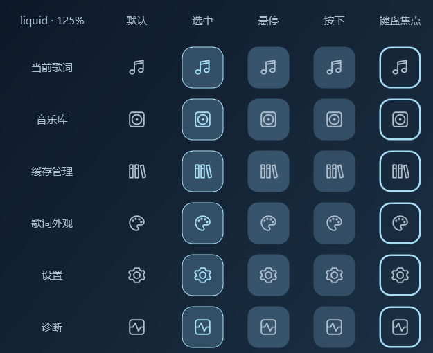

# 0.16.2 左侧导航显示修复

左侧六个入口改用统一的矢量描边，不再通过 Segoe MDL2 字体绘制图标。固定 22 × 22 的图标视口和 48 × 48 的点击区域，导航栏按可用宽度居中，避免原来的边距挤占按钮宽度。图标颜色继续跟随当前应用主题及封面配色。

悬停、按压、选中和键盘焦点保留原来的连续反馈；缩放和位移只作用于背景层，图标不会一起缩放或偏移。六个入口的点击事件、提示文字和辅助功能名称保留，悬浮歌词及独立外观资源不受影响。

新增 36 项导航检查，覆盖三种主题、六个入口、固定图标位置、点击范围、键盘焦点、动画清理、矢量描边边界和抗锯齿颜色。像素检查直接读取透明背景上的图标，确认每个非透明像素均只由当前描边颜色和 alpha 混合而成，防止彩色毛边回归。

以下每张状态图均包含默认、选中、悬停、按下和键盘焦点五列，使用正式导航模板与原创矢量图标。100%／125%／150% 为离屏 DPI 渲染检查，本机窗口实际运行在 Windows 10 22H2、100% 缩放；这不代表已在多显示器之间拖动实测。

| 应用主题 | 100% | 125% | 150% |
| --- | --- | --- | --- |
| 液态玻璃 | [状态图](navigation-states-liquid-100.png) | [状态图](navigation-states-liquid-125.png) | [状态图](navigation-states-liquid-150.png) |
| 毛玻璃 | [状态图](navigation-states-frost-100.png) | [状态图](navigation-states-frost-125.png) | [状态图](navigation-states-frost-150.png) |
| 谷歌平面 | [状态图](navigation-states-material-100.png) | [状态图](navigation-states-material-125.png) | [状态图](navigation-states-material-150.png) |

[液态玻璃主窗口](main-liquid.png) · [毛玻璃主窗口](main-frost.png) · [谷歌平面主窗口](main-material.png)。主窗口和状态图均使用原创文字与图形。

Release 构建零警告、零错误；280 项单元测试通过。[源码完整 WPF 回归](ui-check.json)与[自包含运行包完整回归](ui-check.packaged.json)均为 **751/751**，其中新增导航检查 36 项；三主题交互、布局、独立悬浮外观与此前 62 项玻璃检查继续通过。专项应用设计检查为 121/121。

运行包使用随包 Microsoft host 验证，SDK 列表为空；[程序集 SHA-256](binary-checksums.json)记录五个项目程序集。软件目录及最终 ZIP 通过分发边界和文件一致性检查，2 个软件样例与 32 个私人文件拒绝样例通过。

个人数据与报告使用软件目录之外的新隔离目录；本次没有操作真实 Apple Music。界面检查不能代替原生播放同步、多显示器或长期运行验证。
