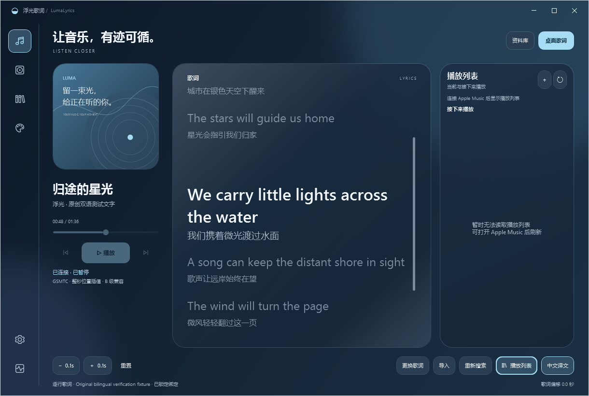
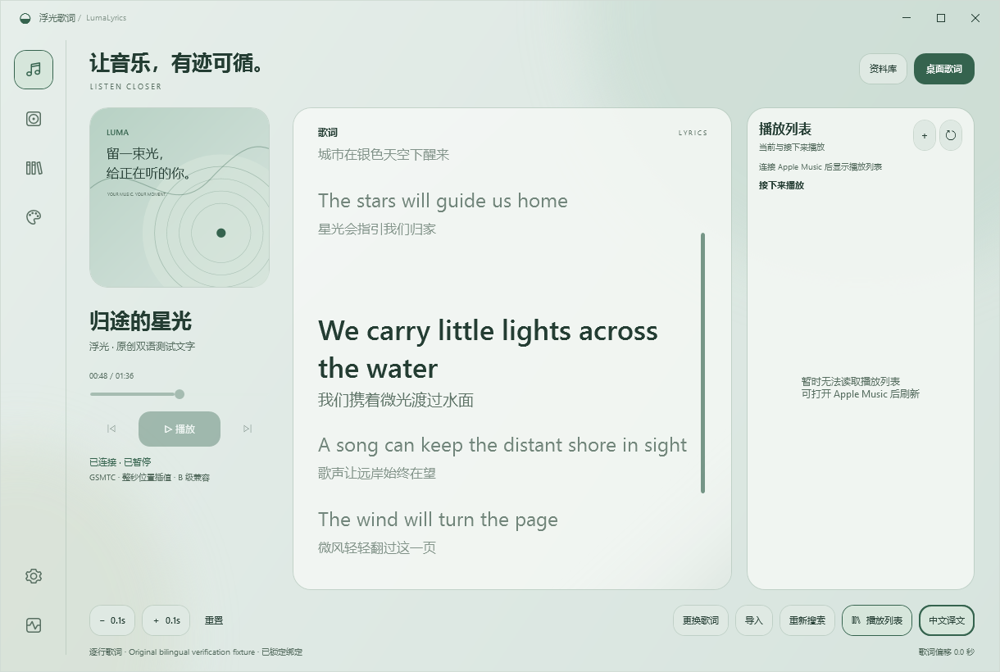
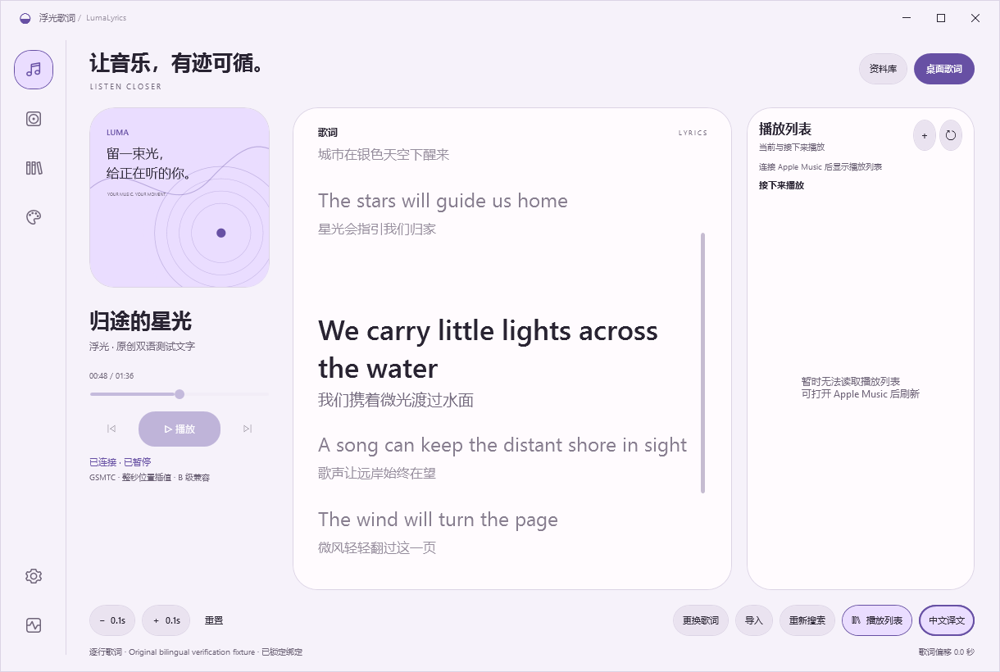

# 主窗口中文译文开关

右下角「中文译文」开关与设置页双向同步，保存主窗口显示偏好；悬浮歌词继续使用独立开关。译文显示在对应原词下方，缺少译文或原词空白时保持原样。

以下画面使用原创双语测试文字和几何封面，来自 770/770 通过的源码完整 WPF 回归。三种主题和 1220／980／820 宽度均检查开关位于窗口内、靠右下方且不与偏移按钮重叠；每个主题检查键盘焦点。

## Liquid Glass

## Frosted Glass

## Material

完整结果和早期失败记录见[0.16.4 验证](../verification-v0164/README.md)。
