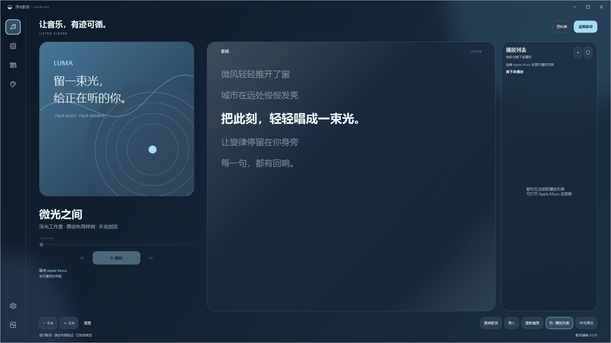
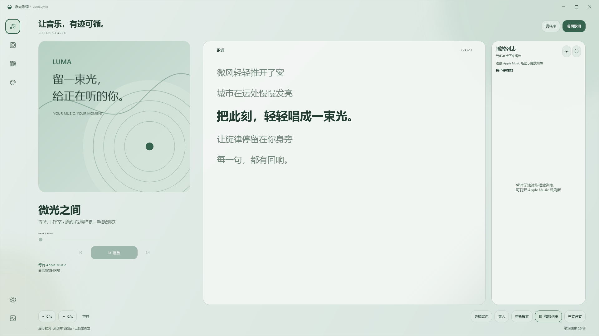
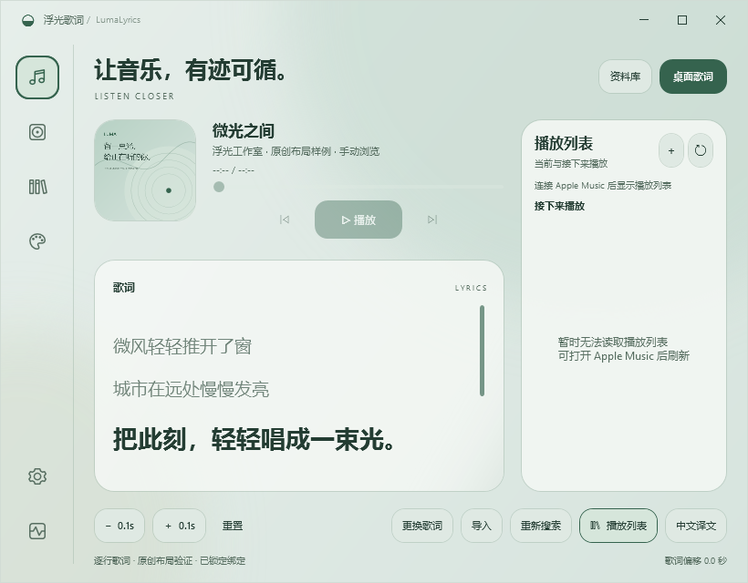
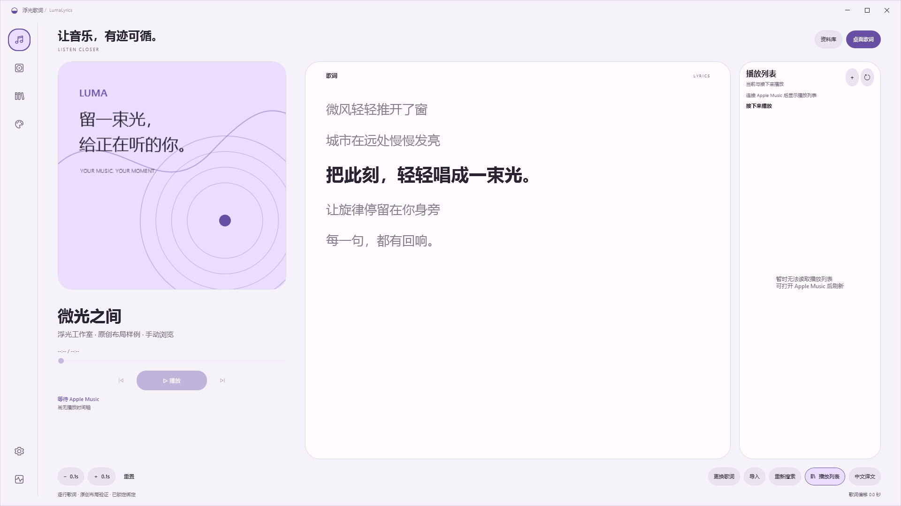

# 窗口缩放与设置内的悬浮外观

播放页按窗口宽度、高度连续分配封面、歌曲信息、歌词和队列空间。大窗口封面随之增长，歌词正文保持适合阅读的行宽；窄窗及高度较小时改为缩略封面和歌曲信息并排，歌词在下方，实际播放队列仍在右侧。字号与留白有上下限，不会随着全屏无限放大。

进入「设置 → 悬浮歌词」即可直接编辑八种悬浮主题、字体、配色、透明度、圆角与动效；原有外观快捷入口统一跳转到此页。预览与控件使用悬浮主题自己的资源，设置外框仍遵循应用主题。

保存外观保留全部访问过的主题并结束临时预览；取消、离开此页或关闭设置还原本次未保存调整。继续修改会开启新会话，保留锁定、显示偏好与主动拖动的位置。

以下为原创文字和几何封面的隔离界面验证，不含个人资料或真实音乐播放。完整结果见 [0.16.5 验证](../verification-v0165/README.md)。

| 主题 | 大窗口 | 窄窗口 | 设置内的外观编辑 |
| --- | --- | --- | --- |
| Liquid |  |  |  |
| Frosted |  |  |  |
| Material |  |  |  |
