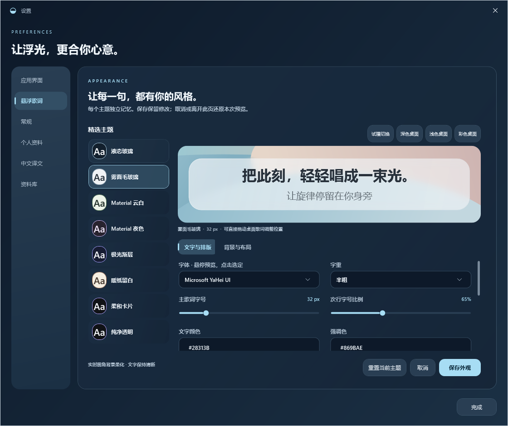
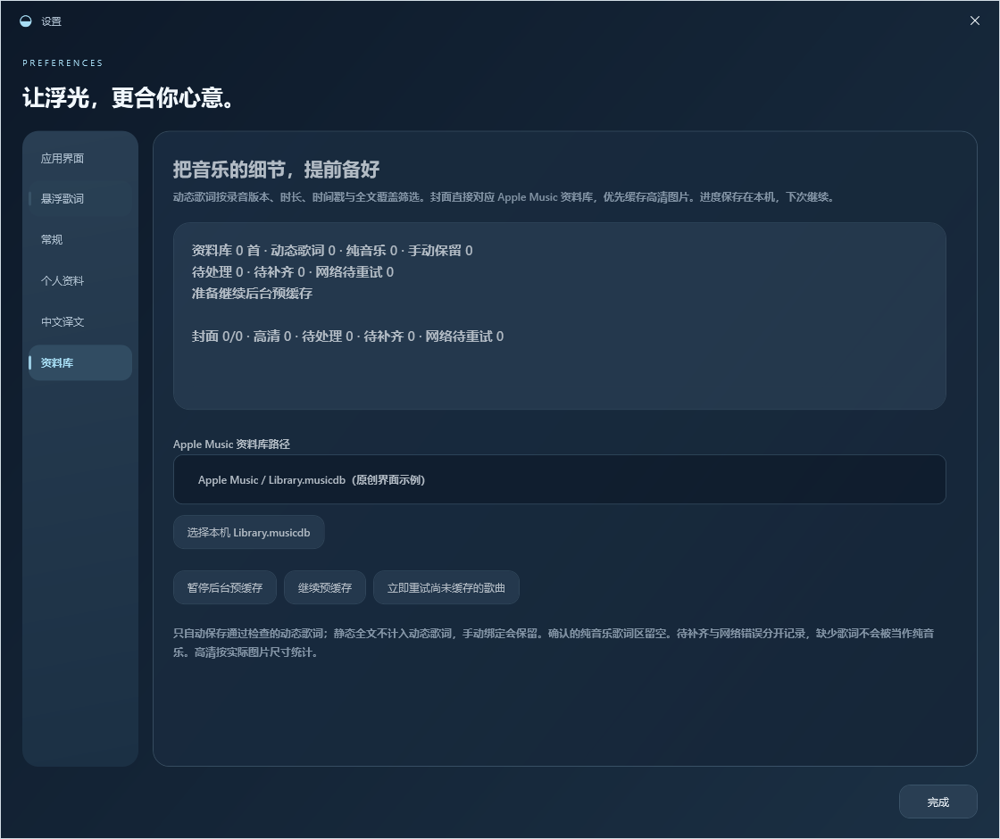
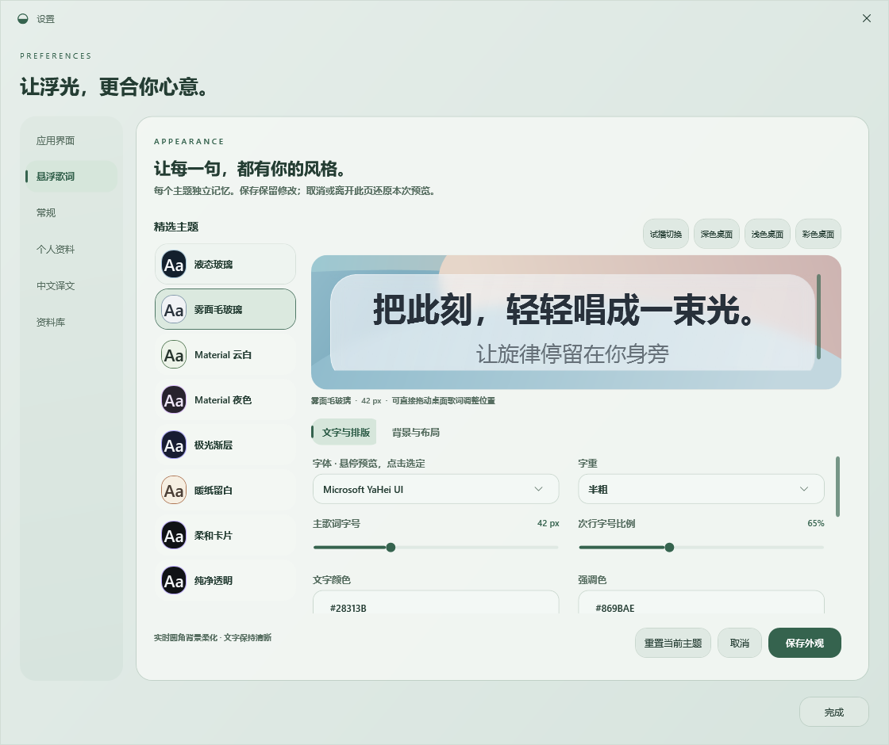
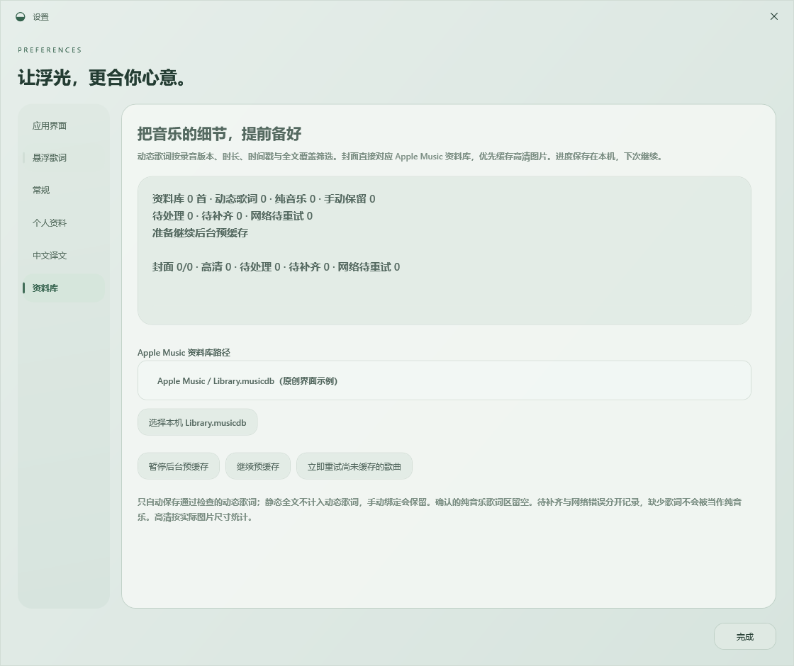
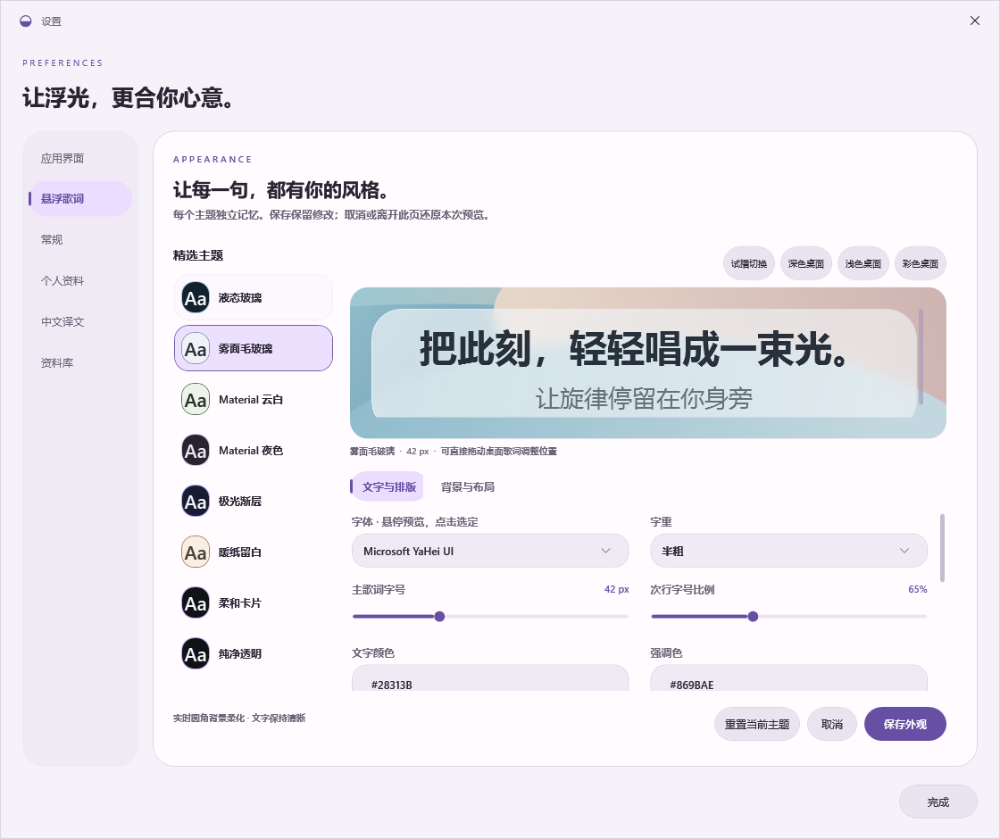
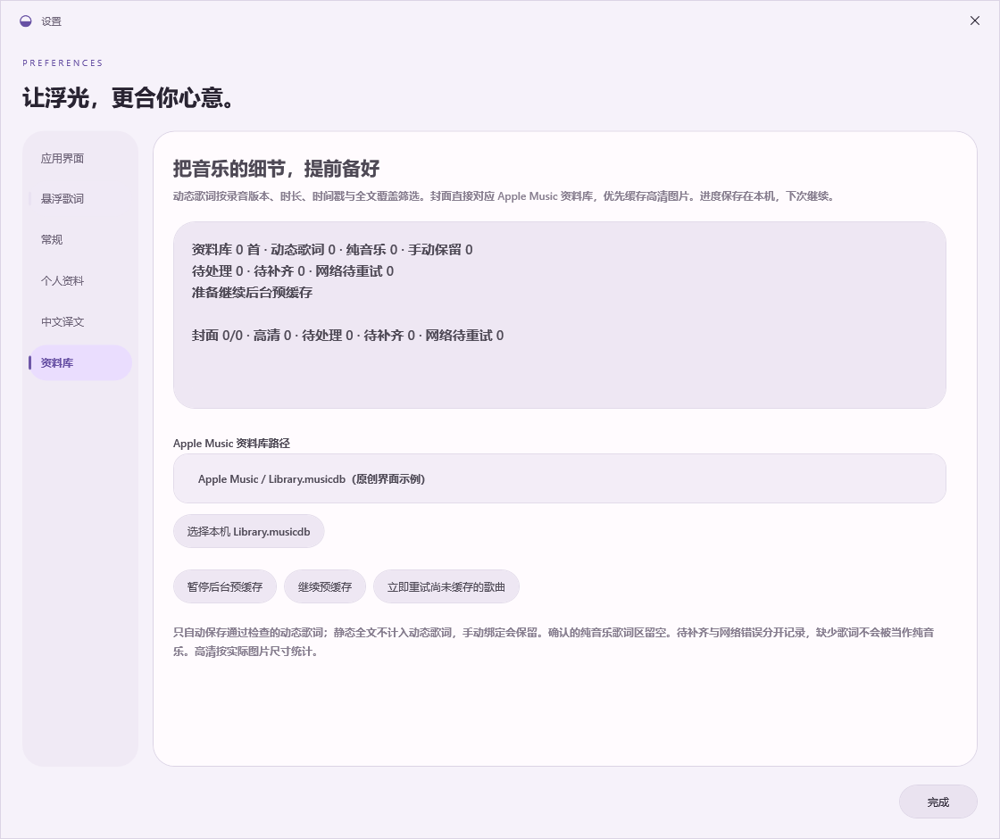

# 设置内的资料库与独立歌词预览

左侧保留当前歌词、音乐库、设置和诊断四个入口。资料库缓存管理归入「设置 → 资料库」，悬浮歌词外观在「设置 → 悬浮歌词」编辑；主界面和音乐库中的缓存快捷入口复用设置窗口。

设置页面、外观表单、按钮、滑块、菜单和横向页签共享主应用主题。切换悬浮主题只改变歌词预览与实际悬浮窗，深色设置里可预览浅色毛玻璃，页面其余部分保持深色。应用主题或封面变化会更新编辑控件，预览像素保持原来的悬浮外观。

八种悬浮主题的独立记忆、保存所有访问过的主题、取消全部草稿、重置当前主题与临时字体预览继续保留。资料库页提供歌词／封面进度、来源路径和暂停／继续／重试操作；离开页面释放界面订阅，后台工作遵循已保存的偏好。

以下截图来自隔离目录中的真实 WPF 客户区，使用原创文字、几何封面和示例路径，不包含个人资料库。[完整验证记录](../verification-v0166/README.md)。

| 应用主题 | 预览浅色悬浮歌词 | 资料库管理 |
| --- | --- | --- |
| Liquid |  |  |
| Frosted |  |  |
| Material |  |  |

640 宽度下的[悬浮外观](settings-compact-liquid.png)和[资料库管理](settings-library-compact-liquid.png)保留可滚动表单与操作。四入口导航的[主界面](application-liquid.png)和[反馈状态](navigation-states-liquid-150.png)继续使用固定矢量图标与平滑背景反馈。
