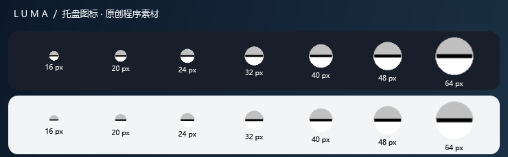

# 托盘与应用图标

托盘与主窗口从程序内嵌资源加载既有浮光图标。`Launch.vbs` 通过随包 Microsoft host 启动时，不再从 `dotnet.exe` 提取图标，也不依赖运行目录旁的外部图片。

下图由实际托盘图标句柄生成，显示 16／20／24／32／40／48／64 像素在深浅背景上的效果；是程序图标预览，不是 Windows 任务栏截图，不包含个人桌面内容。

关闭主窗口后保留托盘恢复入口；菜单和双击处理继续恢复主窗口。退出时先移除通知图标，再释放自身持有的图标和菜单资源。系统决定图标位于可见区域还是折叠菜单，注册成功不能证明它已固定在可见区域。[验证记录](../verification-v0167/README.md)。
