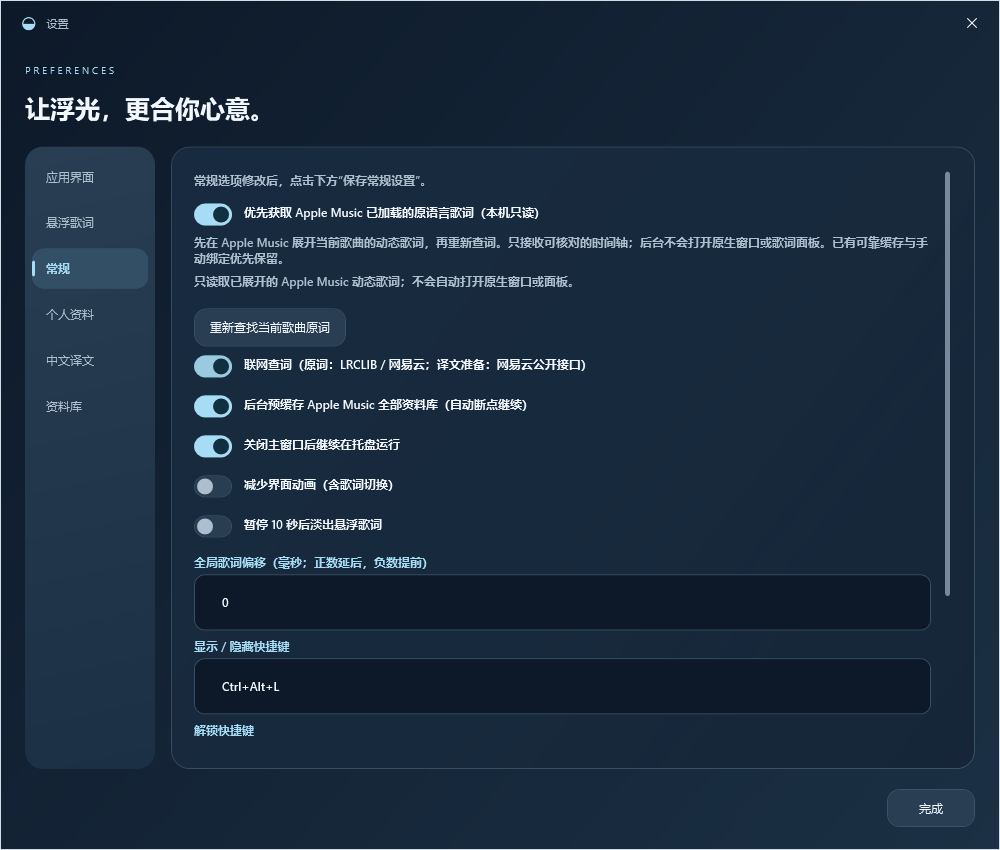
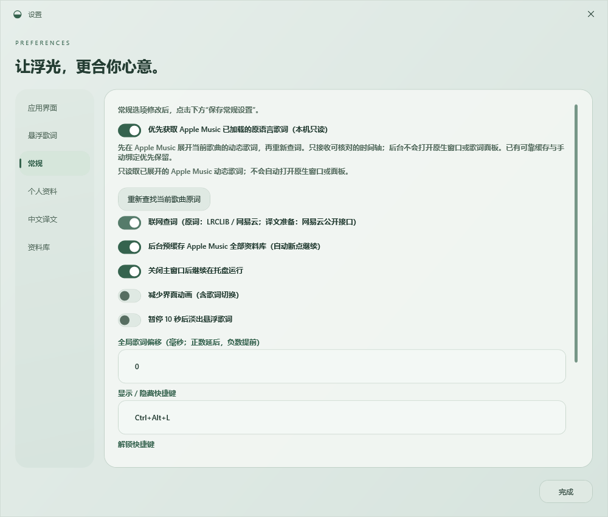
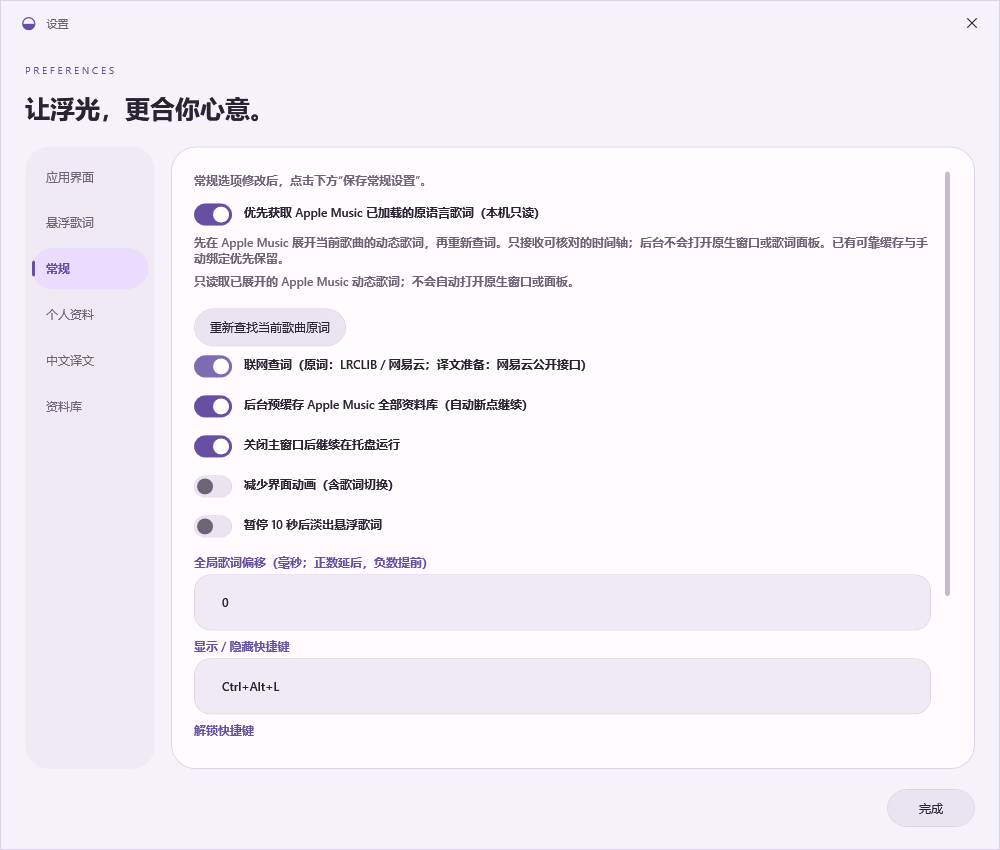

# 原词获取设置 · 0.17.0

「设置 → 常规」新增 Apple Music 本机原词选项、读取条件、进度说明和当前歌曲重新查词入口。三主题沿用应用配色、交互和滚动布局；悬浮外观独立。

以下界面来自隔离回归，只含原创测试内容；真实歌曲、TTML 与原生桌面不进入软件截图。

| 液态玻璃 | 毛玻璃 | 谷歌平面 |
| --- | --- | --- |
|  |  |  |
