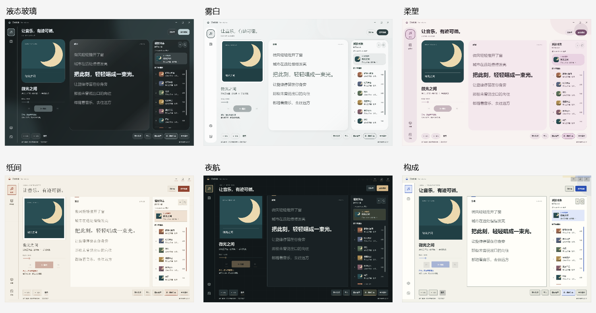

# 六套主应用主题 · 0.18.0

保留液态玻璃，重制雾白与柔塑，新增纸间、夜航、构成。以下是程序实际渲染的页面；歌词、曲目、封面和队列均为原创验证素材，没有个人资料库或网络下载内容。

| 主题 | 设计特征 | 播放页 | 音乐库 | 设置 |
| --- | --- | --- | --- | --- |
| 液态玻璃 | 原有深色流光与封面取色 | [查看](collection-playback-liquid.png) | [查看](collection-library-liquid.png) | [查看](collection-settings-liquid.png) |
| 雾白 | 漫射表面、悬浮导航、照片留边 | [查看](collection-playback-frost.png) | [查看](collection-library-frost.png) | [查看](collection-settings-frost.png) |
| 柔塑 | 胶囊导航、柔和色块、不对称曲线 | [查看](collection-playback-material.png) | [查看](collection-library-material.png) | [查看](collection-settings-material.png) |
| 纸间 | 衬线标题、栏目排版、唱片内页装帧 | [查看](collection-playback-paper.png) | [查看](collection-library-paper.png) | [查看](collection-settings-paper.png) |
| 夜航 | 哑光面板、细网格、等宽标记与刻度 | [查看](collection-playback-studio.png) | [查看](collection-library-studio.png) | [查看](collection-settings-studio.png) |
| 构成 | 几何装帧、粗字重、硬边与控件底板 | [查看](collection-playback-bauhaus.png) | [查看](collection-library-bauhaus.png) | [查看](collection-settings-bauhaus.png) |

在「设置 → 应用界面」选择。宽窗双列、窄窗单列；切换即时保存，旧 frost / material 设置仍可使用。主应用主题不改变悬浮歌词、预览或工具栏，字体菜单的悬停也不进入主题配置。

背景纹理、刻度和主题缩略图均由程序内的原创矢量绘制，不新增下载依赖。标题使用系统字体及中文回退。静态图片不能展示悬停、按压、焦点、切换和减少动画行为；对应检查见[验证记录](../verification-v0180/README.md)。
