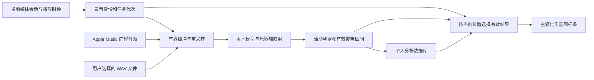

# 乐器活动显示：产品与技术约定

日期：2026-10-27。状态：执行计划的设计基线。当前已实现采集、模型数值验证与缓存／WAV 实验后端，准确度和正式界面仍待验收；实测与限制见 [执行记录](../../instrument-evaluation.md)。

## 用户目标

根据当前播放的音乐，以乐器图标展示演奏状态。歌曲开始时，暗淡显示本曲包含的乐器；播放过程中，同时点亮当前正在演奏的乐器。

用户已接受“整曲预分析或历史缓存 + 实时检测补充 + 播放时钟同步”的实现方向，并要求先编写完整执行计划。

## 产品边界

1. 有完整分析缓存时，显示该录音版本的整曲乐器清单；图标按播放位置点亮。这里的“完整”指分析覆盖完整音频，不表示识别到了现实中所有乐器，也不表示人工核实。
2. 首次播放未知流媒体且没有完整音频时，显示“正在识别，乐器清单逐步完善”。仅加入已稳定识别的类别，不用所有支持类别冒充本曲乐器。
3. 有部分缓存时，开头可显示已知类别，但保留“乐器清单尚未完整”；未分析区间不能以暗色冒充已知没有演奏。
4. 暗色：已知本曲包含该类别，当前有有效证据表明未活动。亮色：当前有效证据表明活动。未知：当前区间没有有效结果，使用描边与文字说明，不能只靠透明度区别。
5. 暂停时保留清单、取消活动高亮并显示“已暂停”；恢复后从当前播放位置重建状态。停止、无会话时不继续亮灯。
6. 先支持乐器族，候选为鼓／打击乐、贝斯、吉他、钢琴／键盘、弦乐、铜管、木管、合成器。候选不等于已支持，只有经过验证的类别才在模型能力清单中启用。人声不作为乐器图标。
7. 模型识别混音中的声音特征；采样、合成音色与真实录制乐器可能不可区分。公开文案使用“识别到的乐器”，不声称识别了真实演奏人员或录音设备。
8. 第一版在主播放页显示。设置、模型安装、缓存清理和本地音频分析均位于 Settings。浮动歌词、工具栏和预览保持独立，第一版不增加浮动乐器条。
9. 新旧配置均默认关闭 `ShowInstrumentActivity` 和 `AnalyzeInstrumentsInBackground`。用户打开功能后才按需安装模型、采集声音；后台分析需独立启用。
10. 不增加主题选择器到播放页，不新增左侧导航项，不创建第二个资料库管理窗口。

## 数据来源与限制

### 实时音频

- 首选 Windows 进程音频回环，目标必须是当前选中的 Apple Music 媒体会话所属应用包中，经实际活动音频会话确认的渲染进程及其子进程。不能假设界面进程就是音频进程；本机实测渲染者为独立的同包 AMPLibraryAgent。
- 不能只按窗口标题或第一个同名进程匹配；绑定包身份、PID、进程启动时间，进程重启后重新解析。
- 原生进程回环要求系统能力检测。微软样例要求 Windows build 20348 或更新；项目目前的最低平台版本是 19041，因此不能无条件调用，也不提升整个应用的最低版本。
- 不自动降级到系统总输出或麦克风。目标不明、能力不足、采集失败时，使用已有精确缓存或显示“实时识别暂不可用”。
- 受保护音频可能无法采集。持续零值或没有缓冲不能单独证明 DRM 原因，也不能证明当前无乐器。
- 采集不启动、切歌、搜索或操纵 Apple Music 播放，不激活或还原原生窗口。

### 整曲分析

- 可使用用户选择的、可解码的完整本地音频。第一版明确支持 PCM16 与 IEEE float32 WAV；其他格式在增加解码器并通过测试后另行支持。
- 文件绑定到当前录音必须由用户明确选择该文件，并确认对应版本；同时记录 SHA-256、时长和绑定来源。时长接近不能单独证明同一录音。
- 仅有歌曲名称、资料库数据库或 Apple Music 下载状态，不能认定可以取得可解码整曲。
- 实时采集可在一次或多次播放中累计覆盖范围。跳过、掉帧、输出设备切换、时间线不可用期间不增加覆盖；重叠区间不重复累计。
- 原始 PCM 只存在于有界内存缓冲。默认不保存录音、不上传音频、不复制用户本地音乐文件。

## 时间、身份与缓存

- 当前会话使用 `SessionId + Generation + Revision + Discontinuity`。拖动进度、同曲循环回零、设备变化、暂停恢复及采集重新连接会增加 `Discontinuity`。
- 实时处理使用单调采样时间；持久时间线必须关联可靠的当前录音身份及可用播放位置。无法建立关系时仅显示实时推断，不写入可复用时间线。
- 复用 `PlaybackClock`，但它对 GSMTC 时间线的插值不能被宣传为精确音符级对齐。记录位置来源、估计误差及采样／推断延迟。
- 不采用歌词全局／单曲偏移校准乐器时间线；二者含义不同。
- 精确缓存键包含来源命名空间、确认的持久录音 ID、时长和可用的音频内容哈希。现有 `Track.Fingerprint` 只包含规范化名称信息，不可直接作为乐器时间线的可信录音键。
- 分析版本由模型权重、标签映射、预处理、阈值及后处理配置共同确定；不同分析版本不能无条件合并。
- 缓存保存模型分数、活动区间、真实覆盖区间、分析版本及来源。分数不是乐器音量。重新判断活动可以使用缓存分数，不重复采集音频。
- “已分析整曲”要求真实有效区间合并后覆盖 `[0, duration]`，允许最多 50 ms 的采样边界容差；这不是准许填补实际丢帧。尾部 padding、模型上下文和重复播放不能补齐未观察内容。
- 缓存覆盖完整只保证时间范围完整。与模型阈值相关的漏检、误检仍然存在。
- 有精确缓存时优先展示时间线；只对缺失区间实时补充。模型版本不兼容的缓存不得混合写入。

## 实现结构

- `Core`：身份、数据契约、活动判定、覆盖合并、过期结果判定；无音频设备和 WPF 依赖。
- `Windows`：进程回环、设备生命周期、音频格式转换及 WAV 读取。
- `Infrastructure`：模型安装与校验、ONNX 推断、分析任务、SQLite 缓存及个人备份。
- `App`：会话协调、设置、主播放页图标、生命周期和隔离 UI 验证。
- 模型评估先比较 YAMNet 与提供时间维度输出的 PANNs；正式客户端采用通过数值对照的 ONNX 模型。若转换或准确度不合格，停留在技术验证阶段，先保留可用的缓存／本地文件路径，不能替换为未经验证的模型发布。
- 代码许可和模型权重许可分别检查。软件包只包含经许可的运行时和公开模型清单；权重按需下载到个人数据目录的 `models/instruments/`。

## 生命周期与性能约束

- 采集回调不运行模型、SQLite 或 UI 操作；缓冲上限 10 秒。推断只处理最新可用窗口，队列积压时丢弃旧窗口并明确留下覆盖空缺。
- 一个模型实例、一个串行推断消费者。UI 与持久写入都必须在提交前再次核对代次，即使模型忽略取消也不能接受旧结果。
- 关闭功能、程序退出、目标进程退出后，取消并释放 COM、音频客户端、事件、计时器与模型资源。
- 主页面不显示且没有明确后台分析需求时停止采集。后台分析开启时允许继续缓存，但不保持隐藏界面动画。
- 本地整曲分析低优先级执行；实时推断优先，整曲分析在窗口之间让出执行，不无限创建并行模型。
- 图标进入／退出使用约 120／240 ms 的可中断渐变；减少动画或系统禁用动画时立即更新。用形状及可访问名称辅助表达状态。
- 主要布局验收为宽度 1220、980、820，队列开关两种状态，100%、150%、200% DPI。至少覆盖 Liquid、Frosted、Material，并回归 `AppThemes.All` 中其余现有主题。
- 鼓点不逐次闪烁；显示乐器活动片段，优先稳定地表达进入和退出。

## 评估门槛（待实测验证的目标，不是现有性能声明）

| 项目 | 目标与测量方法 |
| --- | --- |
| 数据集 | 至少 30 首可合法测试的不同录音；按整首录音划分校准集与留出集，不以同曲片段混入两者 |
| 类别证据 | 每个候选类别的留出集至少覆盖 3 首正例录音、10 个正例片段及 10 个困难负例片段；不足则不宣布支持 |
| 准确度 | 以 0.5 秒时间格评价活动，分别报告各类别 precision、recall；首轮目标 precision ≥ 0.85、recall ≥ 0.65，优先减少误亮；不使用总 accuracy 掩盖负例占比 |
| 时间 | 可清晰标注的进入／退出事件报告 P50、P95 偏差；实时端到端 P95 目标 ≤ 2 秒，测量必须包含采集、模型上下文、推断、防闪及显示 |
| 稳定性 | 连续 30 分钟播放无积压增长、跨曲残留或持续内存增长；关闭后 2 秒内停止接收新结果，正常释放目标 ≤ 5 秒 |
| 资源 | 记录 CPU 型号、逻辑核心数、内存、系统版本及音频输出。单窗口推断 P95 < hop 时长；初始内存增量预算 500 MiB。未达标先缩小模型／类别范围 |
| 缓存同步 | 在确定性虚拟时钟测试中，位置跳转后的显示更新 ≤ 100 ms；不能据此宣称真实 Apple Music 也达到该精度 |

如果可用类别不足以提供明确价值，保留实验开关，记录失败原因，不发布为正式“支持所有乐器”。缩小类别范围与优化模型属于本计划内调整；引入云音频上传或自建训练数据是新的范围决策。

## 交付与验证边界

- G1：Apple Music 进程回环实测报告。失败时明确分为系统不支持、目标无法确认、采集异常或原因不明无有效音频。
- G2：模型评估报告与锁定分析配置。公开报告只含汇总，私人录音、曲名、原生截图和逐曲数据留在个人目录。
- G3：实时检测、完整／部分缓存、本地文件分析、切歌与 seek 的确定性测试通过。
- G4：主题、布局、可访问性、减少动画、个人备份及软件分发边界全部通过。
- UI 模拟验证与真实 Apple Music 验证单独报告；前者不能证明后者。
- 本次交付只包含设计和执行计划。后续实现按任务提交、同步 GitHub；发布前检查远端，不强推。

## 参考资料

- [Windows 进程回环样例](https://learn.microsoft.com/en-us/samples/microsoft/windows-classic-samples/applicationloopbackaudio-sample/)
- [Windows 回环与受保护内容限制](https://learn.microsoft.com/en-us/windows/win32/coreaudio/loopback-recording)
- [YAMNet：输入窗口、标签与官方实现](https://github.com/tensorflow/models/tree/master/research/audioset/yamnet)
- [PANNs：声音事件检测与逐帧输出](https://github.com/qiuqiangkong/audioset_tagging_cnn)
- [ONNX Runtime C#](https://onnxruntime.ai/docs/get-started/with-csharp.html)
- [Demucs 的类别范围与实验性六轨限制](https://github.com/facebookresearch/demucs)

上述资料用于技术选型；实现时再次锁定具体源码版本、权重来源、许可和 SHA-256。
